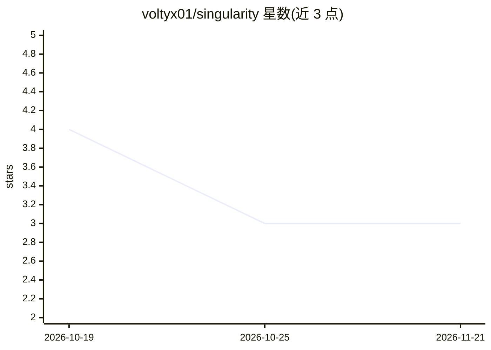

# voltyx01/singularity

⭐ 3 · Python · MIT · 推送 2026-10-14 · [GitHub](https://github.com/voltyx01/singularity) · 个人维护

**协调 Claude Code 与 Antigravity CLI 多代理并行开发的桥接工具**

以约 800 行标准库 Python、零依赖实现的编排桥接层：Claude Code 作为编排者负责任务规划、审查与共享代码所有权，Google Antigravity CLI（`agy`，运行 Gemini 模型）作为无头 worker 并行处理大量文件。核心机制包括 markdown 任务看板（OPEN→CLAIMED→REVIEW→DONE）、仅执行白名单操作的命令网关、独立验证构建/测试的循环、只读审计模式检测行为漂移、配额恢复后自动重启，以及本地 Web 控制台实时查看聊天与任务板。通过 git clone 源码运行，无 API key。

## 筛选速览

| 维度 | 判定 | 备注 |
|---|---|---|
| AI 角色 | `ai-ecosystem` | LLM/agent 周边工具 |
| 许可风险 | `permissive` | MIT |
| 部署形态 | `None` |  |
| 模型依赖 | — | README 未给出锁定关系 |
| 硬件要求 | — | 无带数字的原话,不猜 |
| 安装摩擦 | `low` | 无编译、无系统依赖或容器化 |
| 成熟度 | — | 结构信号不足 |

## 能力要点

- markdown 任务看板与 append-only 消息总线协调编排者与 worker
- 网关 gw.py 仅执行白名单操作（check/grep/commit/post/inbox/diffstat）
- orchestrate.py 无人值守循环：运行 agent→独立验证→带错误重试→升级
- 只读 audit 模式对比新旧代码并输出发现报告，auto_resume 在配额恢复后重启

## 适用场景

- 用强模型做规划审查、廉价模型并行执行大量文件级改动
- 让无头 agent 在受限白名单命令下安全运行
- 多 agent 任务的实时聊天与任务看板监控

## 场景标签

`多智能体` `编码 Agent` · 领域:Agent 开发

## 证据(README 行号)

> L5: A tiny, dependency-free **bridge between an orchestrating AI (Claude Code) and headless worker agents (Google Antigr
> L6: running Gemini models)**. The orchestrator plans, reviews and owns the shared code; the workers grind through hundre
> L11: - Orchestrator tokens are expensive; a worker's quota is separate. Let the cheap model type, let the strong model j

## 星数曲线

2026-10-19 4 → 2026-11-21 3（-1）

---
*卡片 v1 · prompt 1.4 · 生成 2026-11-21 · 置信度 high · 依据 README sha `de5f316d55ed` · [字段定义](../../DATASET.md)*
