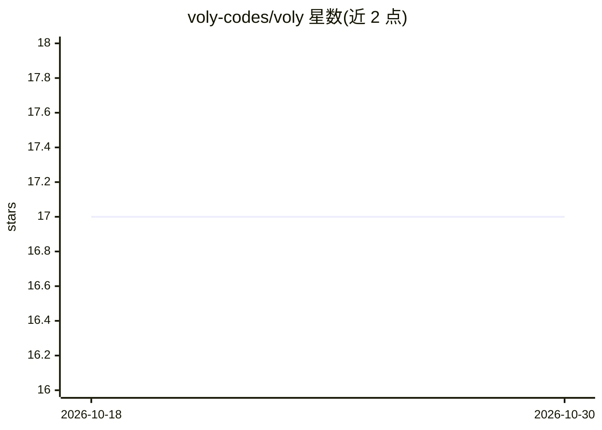

# voly-codes/voly

⭐ 17 · Python · Apache-2.0 · 推送 2026-10-05 · [GitHub](https://github.com/voly-codes/voly) · 组织维护 · 中文 README

**面向开发者的 AI 编码代理自托管控制平面**

位于开发者与 Claude Code、Cursor、DeepSeek、OpenCode 等编码代理之上的自托管控制平面：按任务路由到具备文件能力的执行器并带计费回退链；将复杂任务分解为 architect→developer→tester→reviewer→devops 多角色子代理，混合模式下实现角色走执行器、架构/评审留在对话；通过 Cloudflare AI Gateway 管控支出（BYOK 密钥存于 Cloudflare Secrets Store）；文件写入有 dry-run、保护路径与回滚；磁盘持久缓存与确定性子代理用于降低 token 花费；每次运行产出含成本/token 的遥测。提供 Python SDK、CLI、本地 Web UI；采用开源核心（Apache-2.0）+ 商业云（voly-cloud，托管与团队管理）模式。

## 筛选速览

| 维度 | 判定 | 备注 |
|---|---|---|
| AI 角色 | `ai-ecosystem` | LLM/agent 周边工具 |
| 许可风险 | `permissive` | Apache-2.0 |
| 部署形态 | `library` | 以包/库形式分发 |
| 模型依赖 | locked-api |  |
| 硬件要求 | — | 无带数字的原话,不猜 |
| 安装摩擦 | `low` | 无编译、无系统依赖或容器化 |
| 成熟度 | — | 结构信号不足 |

## 能力要点

- 执行器计费回退链 claude-code→cursor→deepseek→wrangler→opencode→zen
- 多角色任务分解与混合执行（--cwd 下 developer/tester/devops 走执行器）
- 文件写入门控：dry-run diff 预览、保护路径、max-files、git 回滚
- AIGateway.chat() 单一模型出口，DLP→缓存→限流→限额→路由 中间件链
- 六个可复用工作流图工厂（sequential/council/supervisor_workers 等）

## 适用场景

- 把日常 AI 编码代理任务纳入统一入口并按任务追踪成本
- 复杂需求自动拆分为多角色子代理执行并核验
- 给代理写文件设安全边界与回滚
- 通过缓存与模型分层路由控制 token 支出

## 场景标签

`编码 Agent` `多智能体` `模型网关` · 领域:Agent 开发

## 证据(README 行号)

> L18: VOLY is not another AI agent. It is a **self-hosted control plane** between the developer and the agents:
> L20: - **routes** tasks across file-capable executors with an automatic billing fallback chain;
> L148: **`AIGateway.chat()`** is the only exit to **models** (pipeline chat roles, DSPy, runtimes). File-capable **execut

## 星数曲线

2026-10-18 17 → 2026-10-30 17（+0）

---
*卡片 v1 · prompt 1.4 · 生成 2026-10-29 · 置信度 high · 依据 README sha `2d72444101f5` · [字段定义](../../DATASET.md)*
