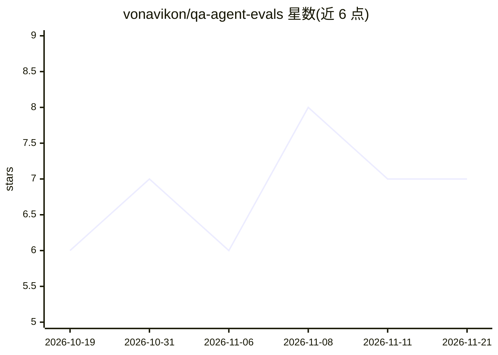

# vonavikon/qa-agent-evals

⭐ 7 · Python · MIT · 推送 2026-11-18 · [GitHub](https://github.com/vonavikon/qa-agent-evals) · 个人维护 · 中文 README

**用角色扮演子代理对 LLM 系统做验收测试的 Claude Code 插件**

以 Claude Code 插件形式运行的验收测试流水线，分 A-E 五步：分析被测系统、经隔离适配器运行场景卡、以另一模型上的 judge 出裁决并生成含通过率与覆盖矩阵的报告。关键机制包括运行前写定的 oracle（必需/禁止事实）、judge 之前先做 grep 机器事实检查、judge 基于含 TruthfulQA/HH-RLHF 的控制样本校准，以及 host/docker 两级执行隔离（第三方被测系统默认 docker，无 Docker 则拒绝运行）。当前仅实现 CLI 与浏览器适配器；judge 需手动指定模型。

## 筛选速览

| 维度 | 判定 | 备注 |
|---|---|---|
| AI 角色 | `ai-ecosystem` | LLM/agent 周边工具 |
| 许可风险 | `permissive` | MIT |
| 部署形态 | `library` | 以包/库形式分发 |
| 模型依赖 | — | README 未给出锁定关系 |
| 硬件要求 | — | 无带数字的原话,不猜 |
| 安装摩擦 | `low` | 无编译、无系统依赖或容器化 |
| 成熟度 | `idea` | |

## 能力要点

- 五类场景卡（含对抗/超纲卡），每张卡带运行前写定的 oracle
- 机器层 grep 检查先于 judge，自相矛盾裁决触发自动重判
- host/docker 两级隔离：docker 下经代理容器仅通 LLM 网关，无 Docker 拒绝启动
- Growing-Golden 反馈回路：仅人工确认的裁决成为金标准样本

## 适用场景

- 给自研 LLM agent 或 skill 上线前做验收测试
- 用对抗卡检查被测系统是否会被注入攻击
- 对非 LLM 系统经浏览器适配器跑确定性验收场景

## 场景标签

`模型评测` · 领域:评测与运维

## 证据(README 行号)

> L10: A Claude Code plugin for acceptance testing of LLM systems with role-playing subagents. You point it at the system 
> L39: - **docker** (default for any third-party SUT: container, network only to the LLM gateway, read-only SUT sources; s
> L47: Requirements: Claude Code, bash, python3. On Windows use Git Bash or WSL.

## 星数曲线

2026-10-19 6 → 2026-11-21 7（+1）

---
*卡片 v1 · prompt 1.4 · 生成 2026-11-20 · 置信度 high · 依据 README sha `59fb47ae5209` · [字段定义](../../DATASET.md)*
