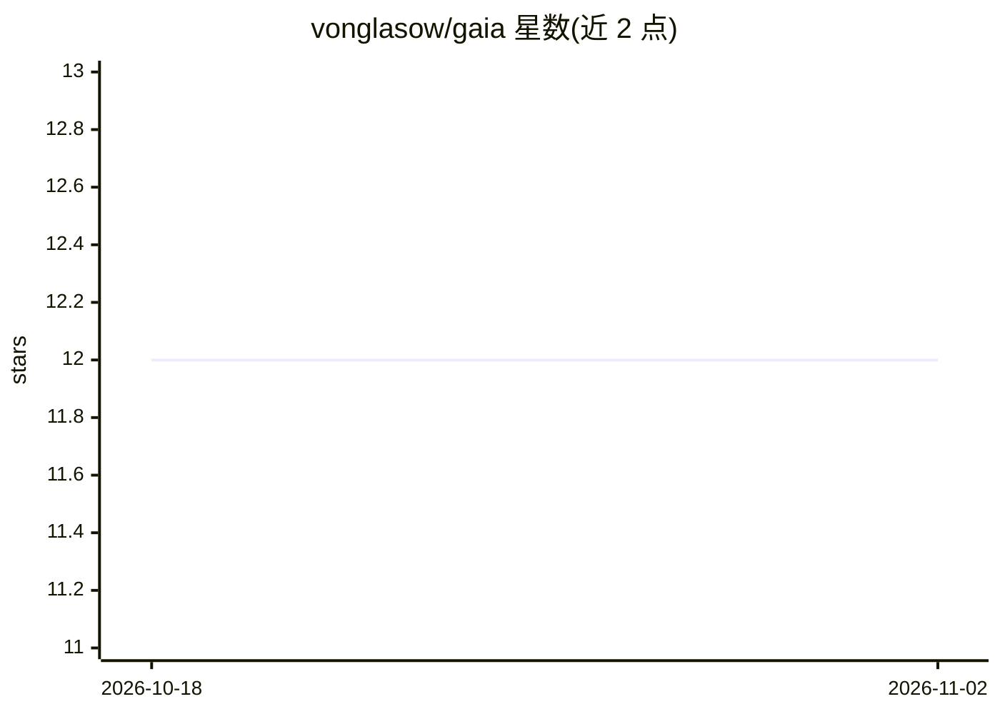

# vonglasow/gaia

⭐ 12 · Go · GPL-3.0 · 推送 2026-10-19 · [GitHub](https://github.com/vonglasow/gaia) · 个人维护

**Go 编写的本地模型 CLI：问答、代理、调查、聊天与 MCP 服务**

Gaia 是用 Go 编写的命令行工具，通过本地 API 与语言模型交互，提供 ask/chat/agent/investigate 等多种模式，并可作为 MCP 守护进程向其他工具暴露能力。内核采用插件架构，所有功能编译进单一二进制，由配置开关。agent 模式带工作区路径限制、命令策略与循环上限三项约束，默认不写文件，需 --write 显式开启。支持 Ollama、OpenAI、Mistral 提供商，可按命令或全局配置模型，可连接远程主机上的模型。

## 筛选速览

| 维度 | 判定 | 备注 |
|---|---|---|
| AI 角色 | `ai-ecosystem` | LLM/agent 周边工具 |
| 许可风险 | `viral` | GPL-3.0 |
| 部署形态 | `None` |  |
| 模型依赖 | local-ok | 支持本地模型 |
| 硬件要求 | — | 无带数字的原话,不猜 |
| 安装摩擦 | `low` | 无编译、无系统依赖或容器化 |
| 成熟度 | — | 结构信号不足 |

## 能力要点

- ask/agent/investigate/chat 多模式，agent 具备 5 个工具与工作区/命令策略/循环上限约束
- 可按命令选择模型与提供商，支持 Ollama/OpenAI/Mistral
- 按实际发送内容自动计算上下文窗口并支持运行中裁剪
- gaia serve 提供 MCP 守护进程，带 bearer token 与 origin 检查

## 适用场景

- 在终端向本地模型提问或围绕项目执行代码代理任务
- 通过 MCP 让其他工具复用 gaia 的能力
- 管理 Ollama 模型驻留内存与上下文窗口占用

## 场景标签

`AI 助手` `编码 Agent` · 领域:编码与开发

## 证据(README 行号)

> L3: A Go CLI for working with local models. The kernel bootstraps the app and manages
> L16: |`gaia ask "…"`|One question to a model. Ollama, OpenAI or Mistral.|
> L21: |`gaia serve`|An MCP daemon, so other tools can reach gaia's tools.|

## 星数曲线

2026-10-18 12 → 2026-11-02 12（+0）

---
*卡片 v1 · prompt 1.4 · 生成 2026-10-31 · 置信度 high · 依据 README sha `f23c91311821` · [字段定义](../../DATASET.md)*
