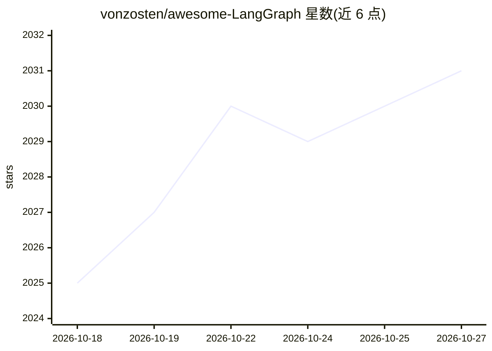

# vonzosten/awesome-LangGraph

⭐ 2,031 · JavaScript · CC0-1.0 · 推送 2026-10-15 · [GitHub](https://github.com/vonzosten/awesome-LangGraph) · 个人维护

**LangChain/LangGraph 生态的索引清单：框架、模板与项目导航**

面向使用 LangChain + LangGraph 技术栈构建 AI agent 的开发者与团队的生态索引清单：按构建、观测、评测、部署的完整生命周期组织条目，收录核心框架（LangChain、LangGraph、Deep Agents、LangSmith）的组件说明、库与 SDK 一览、文档入口（含 llms.txt 的 AI 可访问格式）、集成与 MCP 工具、社区项目（按 RAG、web 自动化、研究、金融等用途分组）及入门模板与学习资源。清单内容以表格与链接形式组织，接受社区贡献。

## 筛选速览

| 维度 | 判定 | 备注 |
|---|---|---|
| AI 角色 | `ai-knowledge` | 知识聚合/清单类 |
| 许可风险 | `viral` | CC0-1.0 |
| 部署形态 | `library` | 以包/库形式分发 |
| 模型依赖 | — | README 未给出锁定关系 |
| 硬件要求 | — | 无带数字的原话,不猜 |
| 安装摩擦 | `low` | 无编译、无系统依赖或容器化 |
| 成熟度 | — | 结构信号不足 |

## 能力要点

- 覆盖构建/观测/评测/部署全生命周期的条目组织
- LangChain 核心组件与高级用法、LangGraph 九项核心能力的结构化说明
- 各框架 Python/TypeScript 库与 SDK 包名一览
- 收录 llms.txt 等 AI 可访问的文档入口

## 适用场景

- 查找 LangChain/LangGraph 生态中的库、模板与工具
- 了解 LangGraph 的持久化、中断、时间旅行等能力与包结构
- 为构建多 agent 应用挑选入门模板与学习资源

## 场景标签

`精选清单` · 领域:学习与行业

## 证据(README 行号)

> L3: > The definitive index of frameworks, templates, and real-world projects for teams that want to **build, observe, ev
> L8: - Core frameworks: LangChain, LangGraph, Deep Agents, and LangSmith
> L12: - Community projects grouped by use case (RAG, web automation, research, finance, etc.)

## 星数曲线

2026-10-18 2,025 → 2026-10-27 2,031（+6）

---
*卡片 v1 · prompt 1.4 · 生成 2026-10-21 · 置信度 mid · 依据 README sha `361309f33be7` · [字段定义](../../DATASET.md)*
