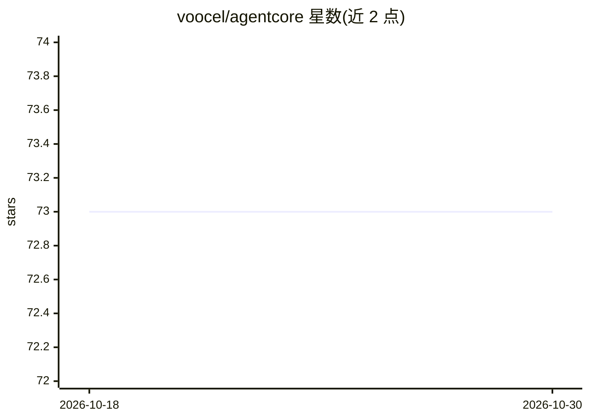

# voocel/agentcore

⭐ 73 · Go · Apache-2.0 · 推送 2026-10-18 · [GitHub](https://github.com/voocel/agentcore) · 个人维护 · 中文 README

**构建 AI Agent 的极简可组合 Go 库**

Go 语言 AI agent 构建库，基于 litellm 提供模型-工具循环：Run 接收历史并返回结束后的历史，调用方持有历史。核心机制包括有序事件流（MessageStart/Delta/End、ToolStart/End、Compaction 等）、工具中间件用于审批/审计、上下文超限时的历史压缩（Summarizer 检查点）、subagent 委托（并行/链式/后台）、后台任务运行时。内置 read/write/edit/bash/glob/grep/ls 编码工具。审批、权限、提示词等策略层留给应用。需 Go 1.26+，bash 工具在 Windows 上需 Git Bash。

## 筛选速览

| 维度 | 判定 | 备注 |
|---|---|---|
| AI 角色 | `ai-ecosystem` | LLM/agent 周边工具 |
| 许可风险 | `permissive` | Apache-2.0 |
| 部署形态 | `None` |  |
| 模型依赖 | locked-api |  |
| 硬件要求 | — | 无带数字的原话,不猜 |
| 安装摩擦 | `low` | 无编译、无系统依赖或容器化 |
| 成熟度 | — | 结构信号不足 |

## 能力要点

- 无状态 agent 循环：Run 接收并返回历史，调用方持有
- 单一回调的有序事件流，Emit 返回错误即停止运行
- 工具中间件（Middleware）实现审批、审计与参数改写
- Summarizer 历史压缩与上下文溢出自动重试
- subagent 委托（并行/链式/后台）与后台任务运行时

## 适用场景

- 用 Go 构建带工具调用的 LLM agent 应用
- 实现编码类 agent（读写文件、执行命令、并行子 agent）
- 在应用层自定义审批与权限策略的工具调用流程

## 场景标签

`Agent 框架` `多智能体` · 领域:Agent 开发

## 证据(README 行号)

> L3: **AgentCore** is a small Go library for building AI agents: a model that calls tools, turn by turn, until its task i
> L21: agentcore    the agent: the loop, tools, events, compaction

## 星数曲线

2026-10-18 73 → 2026-10-30 73（+0）

---
*卡片 v1 · prompt 1.4 · 生成 2026-10-24 · 置信度 high · 依据 README sha `adefde1545c3` · [字段定义](../../DATASET.md)*
