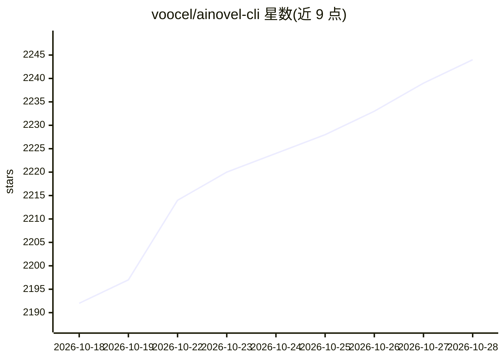

# voocel/ainovel-cli

⭐ 2,244 · Go · Apache-2.0 · 推送 2026-10-25 · [GitHub](https://github.com/voocel/ainovel-cli) · 个人维护 · 中文 README

**多 agent 全自动长篇小说生成 CLI，从一句话到成书**

用 Go 编写的命令行小说创作引擎：确定性 Engine 按事实决策表调度 Architect / Writer / Editor 三个自主代理，语义判断（选规划师、干预分诊等）由按需唤醒的 Arbiter 单次 LLM 调用完成并落盘可回放。支持 500+ 章长篇的卷弧滚动规划、分层摘要与上下文压缩、Step 级断点恢复、实时干预与逐章验收，提供 TUI 与 Headless 双入口及 Docker 运行方式；多 LLM Provider 可配置切换。面向希望全自动或半自动产出长篇小说的用户。

## 筛选速览

| 维度 | 判定 | 备注 |
|---|---|---|
| AI 角色 | `ai-native` | 本体是模型或模型工具 |
| 许可风险 | `permissive` | Apache-2.0 |
| 部署形态 | `self-host` | docker 或自建部署 |
| 模型依赖 | locked-api |  |
| 硬件要求 | — | 无带数字的原话,不猜 |
| 安装摩擦 | `low` | 无编译、无系统依赖或容器化 |
| 成熟度 | — | 结构信号不足 |

## 能力要点

- 确定性 Engine + Architect/Writer/Editor 三代理，主循环零 LLM 开销
- 卷弧双层滚动规划与分层摘要，支持 500+ 章长篇连续性
- 七维质量评审（每项需引用原文举证）与 Step 级断点恢复
- TUI + Headless 双入口，支持实时干预、手动修订同步与已有小说导入续写

## 适用场景

- 从一句话需求全自动生成长篇小说
- 在服务器/NAS 上无人值守持续跑写作任务
- 导入已有小说做语义编译后续写
- 放入参考语料生成仿写画像指导创作风格

## 场景标签

`多智能体` `AI 写作` · 领域:Agent 开发

## 证据(README 行号)

> L3: 全自动 AI 长篇小说创作引擎。确定性引擎跑完整本书，模型在每个需要判断的位置被精确使用：Engine 按事实路由驱动 Architect / Writer / Editor 三个自主创作代理，语义裁定按需唤醒 Arbiter。从一
> L10: - **确定性引擎 + 多智能体协作** — Engine 按事实决策表调度 Architect / Writer / Editor 三个自主创作代理，主循环零 LLM 开销、行为可穷举测试
> L20: - **多 LLM 支持** — OpenRouter / Anthropic / Gemini / OpenAI 等等随意切换

## 星数曲线

2026-10-18 2,192 → 2026-10-28 2,244（+52）

---
*卡片 v1 · prompt 1.4 · 生成 2026-10-21 · 置信度 high · 依据 README sha `3cb837872b25` · [字段定义](../../DATASET.md)*
