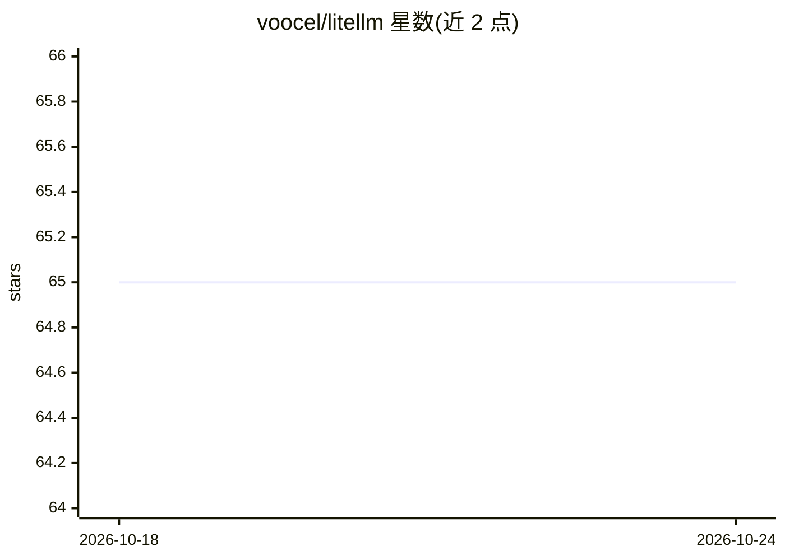

# voocel/litellm

⭐ 65 · Go · Apache-2.0 · 推送 2026-10-18 · [GitHub](https://github.com/voocel/litellm) · 个人维护 · 中文 README

**Go 语言多供应商 LLM 调用 SDK 与自托管网关**

LiteLLM Go 是一个类型化的 Go SDK：根包提供与供应商无关的 API，具体供应商（OpenAI、Anthropic、Gemini、Bedrock、Ollama 等 14 个）位于 provider/<name> 子包，另含 compat 包接入任意 OpenAI 兼容端点。核心机制包括有序 Block 消息模型、流式聚合、工具调用与延迟加载、结构化输出、Thinking、提示缓存、ProviderOptions 原生字段透传。SDK 只做结构映射、不做本地校验或输入重写；gateway 包可自托管网关，由调用方自行实现认证与计量。需要 Go 1.26+。

## 筛选速览

| 维度 | 判定 | 备注 |
|---|---|---|
| AI 角色 | `ai-ecosystem` | LLM/agent 周边工具 |
| 许可风险 | `permissive` | Apache-2.0 |
| 部署形态 | `None` |  |
| 模型依赖 | local-ok | 支持本地模型 |
| 硬件要求 | — | 无带数字的原话,不猜 |
| 安装摩擦 | `low` | 无编译、无系统依赖或容器化 |
| 成熟度 | — | 结构信号不足 |

## 能力要点

- 14 个内置 provider 子包 + compat 兼容任意 OpenAI 兼容端点
- 有序 Block 核心模型（Text/Reasoning/ToolUse 等），历史可跨供应商迁移
- 流式聚合、工具延迟加载、提示缓存与原生字段透传
- gateway 包提供自托管网关：路由、改写请求、心跳保活，认证与计量留给调用方

## 适用场景

- Go 项目中以统一类型接口调用多家 LLM 供应商
- 按配置名动态构建 provider 的多模型应用
- 在沙箱 agent 前部署网关，避免向其暴露厂商密钥

## 场景标签

`模型网关` · 领域:Agent 开发

## 证据(README 行号)

> L5: LiteLLM is a small, explicit Go SDK for calling LLM providers through one typed core model. The root package owns th
> L130: ## Providers

## 星数曲线

2026-10-18 65 → 2026-10-24 65（+0）

---
*卡片 v1 · prompt 1.4 · 生成 2026-10-24 · 置信度 high · 依据 README sha `ab41d585f71c` · [字段定义](../../DATASET.md)*
