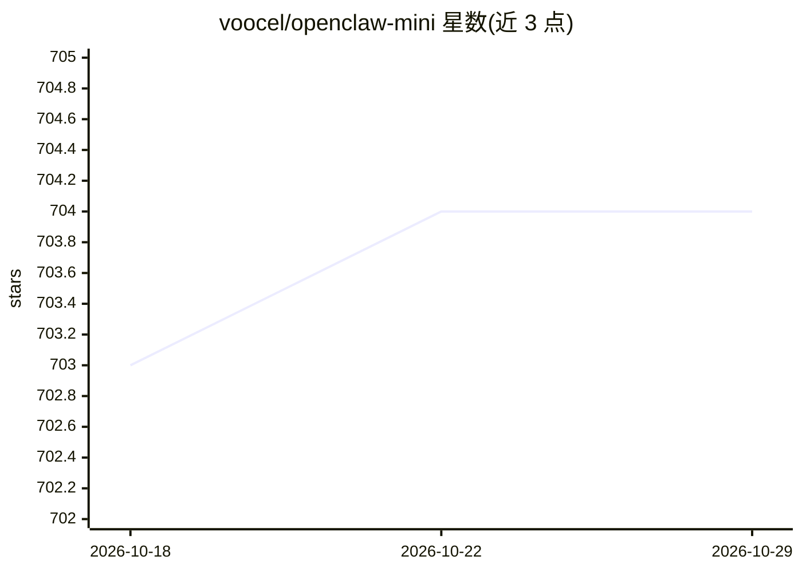

# voocel/openclaw-mini

⭐ 704 · TypeScript · MIT · 推送 2026-05-31 · [GitHub](https://github.com/voocel/openclaw-mini) · 个人维护 · 中文 README

**给学习者的 OpenClaw 核心架构极简复现，含 Agent Loop、记忆与网关**

用一个小而完整的 TypeScript 项目复现 OpenClaw Agent 系统的核心设计，供读者学习 Agent Loop 双层循环、EventStream 事件流、Session JSONL 持久化、上下文裁剪与摘要压缩、关键词检索长期记忆、SKILL.md 技能、主动心跳唤醒与 WebSocket RPC Gateway。基于 pi-ai 适配层支持 Anthropic/OpenAI 等 22+ 提供商，通过 OpenAI 兼容 API 可接入智谱、DeepSeek、Kimi 等模型。明确不追求与主仓库 1:1 API 兼容，不覆盖生产级防护细节。

## 筛选速览

| 维度 | 判定 | 备注 |
|---|---|---|
| AI 角色 | `ai-ecosystem` | LLM/agent 周边工具 |
| 许可风险 | `permissive` | MIT |
| 部署形态 | `library` | 以包/库形式分发 |
| 模型依赖 | locked-api |  |
| 硬件要求 | — | 无带数字的原话,不猜 |
| 安装摩擦 | `low` | 无编译、无系统依赖或容器化 |
| 成熟度 | — | 结构信号不足 |

## 能力要点

- 双层 Agent Loop（follow-up + tools/steering）与 EventStream 异步事件流
- 三层递进上下文裁剪 + 自适应摘要压缩 + 压缩前记忆刷写
- 关键词检索长期记忆与 SKILL.md 技能系统、心跳主动唤醒
- WebSocket RPC Gateway：Challenge-Response 认证、Pub/Sub 广播、背压与重连

## 适用场景

- 学习生产级 AI Agent 的系统级架构设计
- 按核心→扩展→网关→工程分层阅读可运行的最小实现
- 通过 OpenAI 兼容 API 接入智谱/DeepSeek 等模型做实验
- 将 Agent 从 CLI 直连升级为多客户端共享的网络服务

## 场景标签

`教程课程` · 领域:学习与行业

## 证据(README 行号)

> L3: **OpenClaw 核心架构的精简复现，用于学习 AI Agent 的系统级设计。**
> L88: OpenClaw 是一个超 43w 行的复杂 Agent 系统，本项目从中提炼出核心设计与最小实现，帮助你理解：

## 星数曲线

2026-10-18 703 → 2026-10-29 704（+1）

---
*卡片 v1 · prompt 1.4 · 生成 2026-10-21 · 置信度 mid · 依据 README sha `41bef03056ad` · [字段定义](../../DATASET.md)*
