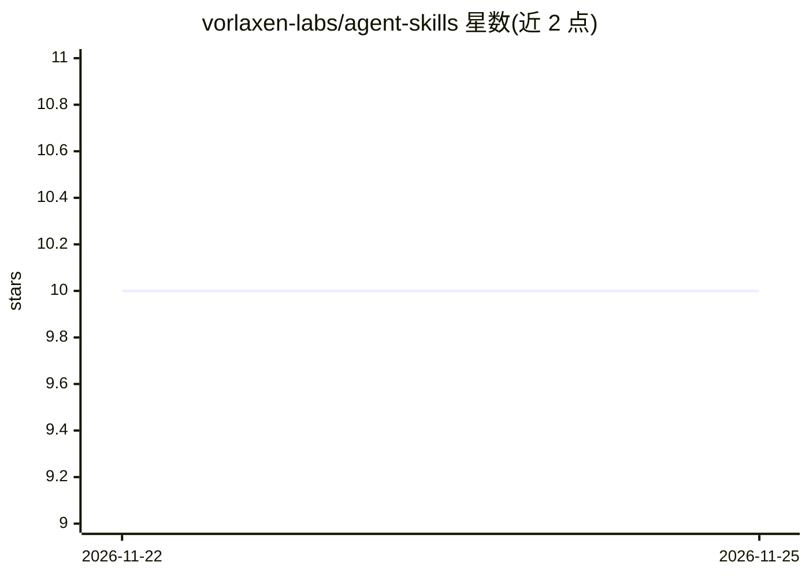

# vorlaxen-labs/agent-skills

⭐ 10 · TypeScript · MIT · 推送 2026-11-23 · [GitHub](https://github.com/vorlaxen-labs/agent-skills) · [官网](https://www.npmjs.com/package/@vorlaxen-labs/agent-skills) · 组织维护

**为 AI 编码工具安装 SKILL.md 技能并生成 AGENTS.md 的 CLI**

Vorlaxen Labs 出品的 npm CLI，提供 init/add/hub/update/remove/doctor/list 等子命令：初始化全局 AGENTS.md 工程规范，从任意 GitHub 仓库或本地路径安装 SKILL.md 技能包，并写入 skills-lock.json 锁文件实现可复现安装。支持 Cursor、Claude Code、GitHub Copilot、Windsurf、Codex、Gemini CLI 等读取 .cursor/skills 等目录的工具；本仓库自身只内置默认规范，不含技能目录。

## 筛选速览

| 维度 | 判定 | 备注 |
|---|---|---|
| AI 角色 | `ai-ecosystem` | LLM/agent 周边工具 |
| 许可风险 | `permissive` | MIT |
| 部署形态 | `library` | 以包/库形式分发 |
| 模型依赖 | — | README 未给出锁定关系 |
| 硬件要求 | — | 无带数字的原话,不猜 |
| 安装摩擦 | `low` | 无编译、无系统依赖或容器化 |
| 成熟度 | — | 结构信号不足 |

## 能力要点

- init 生成 AGENTS.md 全局工程标准
- add 从任意 GitHub 仓库安装 SKILL.md 技能
- skills-lock.json 锁文件，与 vercel-labs/skills 兼容
- doctor/list/hub 等 CLI 子命令管理技能与冲突

## 适用场景

- 团队用 AGENTS.md 统一 AI agent 行为规范
- 在多个 AI 编码工具间批量安装同一套技能
- 通过锁文件让项目技能安装可复现

## 场景标签

`提示工程` · 领域:Agent 开发

## 证据(README 行号)

> L9: **`npx` CLI by Vorlaxen Labs** to bootstrap **`AGENTS.md` engineering standards** and **install agent skills from an
> L26: |**Loader CLI**|`init`, `add`, `hub`, `update`, `remove`, `doctor`, `list`|
> L40: - Projects that need **reproducible** skill installs via **`skills-lock.json`** (compatible with vercel-labs/skills

## 星数曲线

2026-11-22 10 → 2026-11-25 10（+0）

---
*卡片 v1 · prompt 1.4 · 生成 2026-11-22 · 置信度 high · 依据 README sha `2f09c355395a` · [字段定义](../../DATASET.md)*
