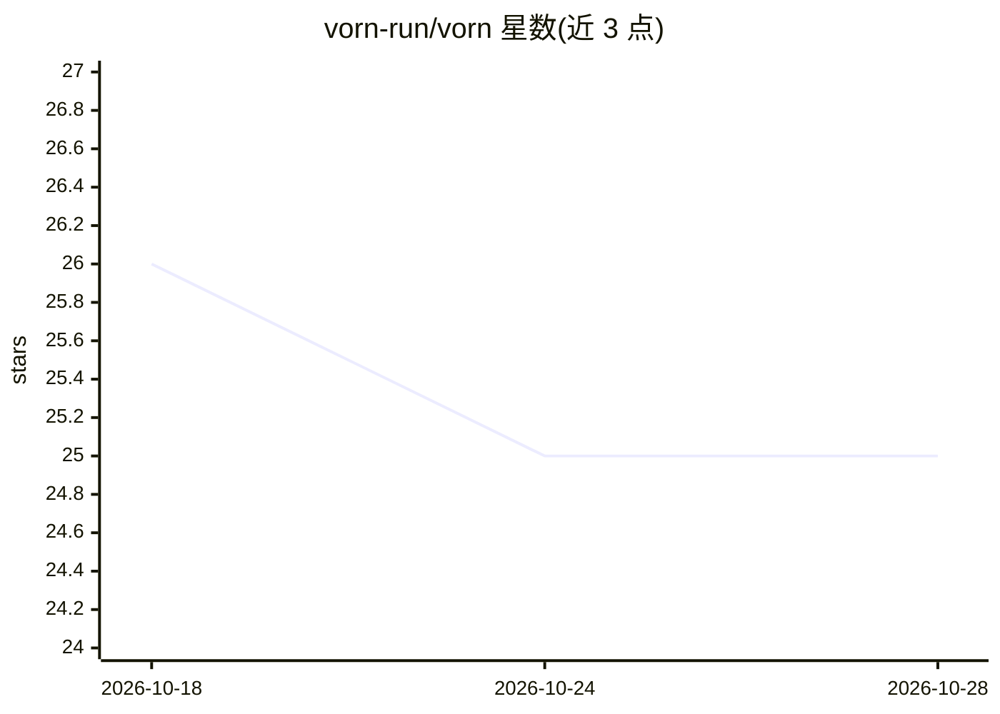

# vorn-run/vorn

⭐ 25 · Rust · MIT · 推送 2026-10-28 · [GitHub](https://github.com/vorn-run/vorn) · [官网](https://vorn.run) · 组织维护

**本地多智能体指挥中心：并行运行与编排 Claude/Copilot/Codex 等 CLI agent**

桌面应用加本地服务端形态的 agent 编排工具：以网格终端并行运行 Claude、Copilot、Codex、Gemini 等 CLI agent（各自独立 PTY），也支持无头后台执行；提供任务队列与看板、可视化多步骤工作流（含 cron 定时与任务状态触发）、内置 MCP server 供 agent 读写任务与项目状态、git 集成与 worktree 隔离、artifacts 审阅机制。安装提供 macOS/Linux/Windows 脚本、Homebrew cask 与 dmg/exe/AppImage/deb 安装包，Linux 需 WebKitGTK 4.1 与 GTK 3。项目自述处于 alpha 阶段。

## 筛选速览

| 维度 | 判定 | 备注 |
|---|---|---|
| AI 角色 | `ai-ecosystem` | LLM/agent 周边工具 |
| 许可风险 | `permissive` | MIT |
| 部署形态 | `desktop` | 安装包/桌面程序 |
| 模型依赖 | — | README 未给出锁定关系 |
| 硬件要求 | — | 无带数字的原话,不猜 |
| 安装摩擦 | `low` | 无编译、无系统依赖或容器化 |
| 成熟度 | `idea` | |

## 能力要点

- 网格终端并行运行多个 CLI agent，各自独立 PTY，无需 API key 或包装层
- TOML 布局与可视化工作流：串联 agent 启动、脚本执行与任务操作，支持 cron 与状态触发
- 内置 MCP server，agent 可读写任务、触发工作流、查询项目状态
- CLI（vorn）与 JSON 输出、事件流，可脚本化驱动会话

## 适用场景

- 在同一界面并行驱动多个 CLI 编码 agent 处理不同任务
- 定义自动代码审查、文档生成、测试运行的工作流并定时触发
- 通过任务看板分派任务，由 agent 以任务描述为提示自动执行

## 场景标签

`多智能体` · 领域:Agent 开发

## 证据(README 行号)

> L3:  The agent command center
> L24: **Like vibecoding interactively?** Open multiple terminals and pair with several agents at once — Claude on one tas
> L172: Vorn supports two ways of working. **Interactive**: open a grid of terminals and pair with agents hands-on. **Auto

## 星数曲线

2026-10-18 26 → 2026-10-28 25（-1）

---
*卡片 v1 · prompt 1.4 · 生成 2026-10-26 · 置信度 high · 依据 README sha `117cc1feda37` · [字段定义](../../DATASET.md)*
