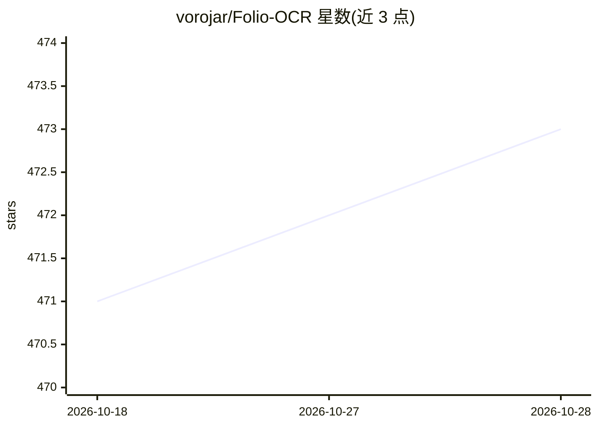

# vorojar/Folio-OCR

⭐ 474 · Python · MIT · 推送 2026-06-18 · [GitHub](https://github.com/vorojar/Folio-OCR) · [官网](https://vorojar.github.io/Folio-OCR/) · 个人维护 · 中文 README

**本地批量 OCR 工作台：把扫描 PDF/图片转可编辑文本**

基于 GLM-OCR（经 Ollama 运行视觉 OCR）与 PP-DocLayoutV3（版面分区）的三栏 Web 工作台，输入 PDF/PNG/JPG/GIF/BMP 混合批量上传，输出 Markdown、TXT、Word、EPUB，并尽量保留标题、正文、表格结构。提供三栏编辑界面、版面区域双向高亮、SQLite 持久化与批量识别进度控制。默认本地运行，文档不上传第三方服务；需已安装 Ollama 并拉取 glm-ocr 模型，可通过 uvx/pipx、Docker Compose 或源码三种方式启动。

## 筛选速览

| 维度 | 判定 | 备注 |
|---|---|---|
| AI 角色 | `ai-native` | 本体是模型或模型工具 |
| 许可风险 | `permissive` | MIT |
| 部署形态 | `self-host` | docker 或自建部署 |
| 模型依赖 | local-ok | 支持本地模型 |
| 硬件要求 | — | 无带数字的原话,不猜 |
| 安装摩擦 | `low` | 无编译、无系统依赖或容器化 |
| 成熟度 | — | 结构信号不足 |

## 能力要点

- PP-DocLayoutV3 版面分区 + GLM-OCR 视觉 OCR 的本地流水线
- 导出 Markdown/TXT/Word/EPUB 四种格式，保留表格与章节结构
- 相邻文本区域合并减少 OCR 调用（11 区域 → 3 组）
- SQLite 持久化、多文档管理、800ms 防抖自动保存

## 适用场景

- 把扫描书籍或文档照片批量转成可编辑文本
- 表格文档转写并保留结构后导出 Word/EPUB
- 隐私敏感、不能上传第三方 OCR 服务的离线识别

## 场景标签

`OCR` `文档解析` · 领域:知识与检索

## 证据(README 行号)

> L18: - **处理**：PP-DocLayoutV3 做版面分区，GLM-OCR 通过 Ollama 做视觉 OCR。
> L19: - **输出**：Markdown、TXT、Word `.docx`、EPUB。

## 星数曲线

2026-10-18 471 → 2026-10-28 473（+2）

---
*卡片 v1 · prompt 1.4 · 生成 2026-10-21 · 置信度 mid · 依据 README sha `db417cc8e718` · [字段定义](../../DATASET.md)*
