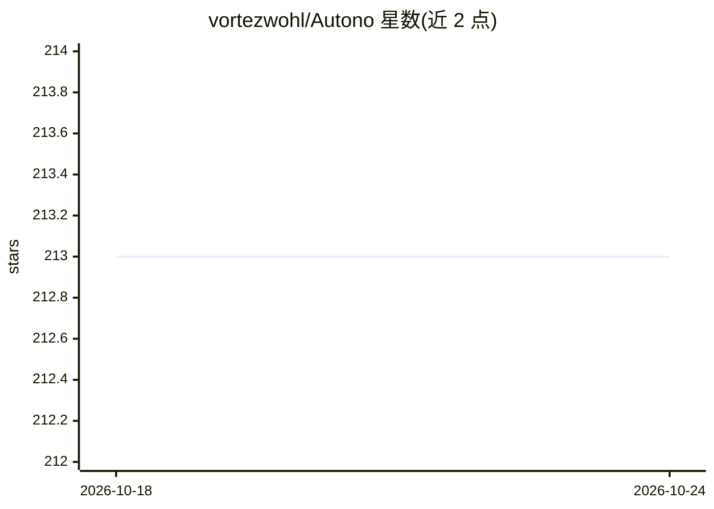

# vortezwohl/Autono

⭐ 213 · Python · GPL-3.0 · 推送 2026-06-23 · [GitHub](https://github.com/vortezwohl/Autono) · [官网](https://doi.org/10.48550/arXiv.2504.04650) · 个人维护 · 中文 README

**基于 ReAct 的多智能体自主执行框架（Python 库）**

面向开发者的 Python 自主智能体框架：基于 ReAct 范式在执行中依据历史轨迹动态生成下一步动作，含及时放弃策略（概率惩罚机制调节放弃概率）与多智能体记忆传递机制。通过 @ability 装饰器把函数注册为能力，McpAgent 支持 MCP 协议（stdio/SSE/WebSocket）接入外部工具，Personality 枚举调节谨慎/探索倾向，并提供 BeforeActionTaken/AfterActionTaken 两个钩子实现过程观测与干预。附 arXiv 论文及与 autogen、langchain 的对比实验，GPL-3.0 许可，单人（Zihao Wu）维护。

## 筛选速览

| 维度 | 判定 | 备注 |
|---|---|---|
| AI 角色 | `ai-ecosystem` | LLM/agent 周边工具 |
| 许可风险 | `viral` | GPL-3.0 |
| 部署形态 | `library` | 以包/库形式分发 |
| 模型依赖 | — | README 未给出锁定关系 |
| 硬件要求 | — | 无带数字的原话,不猜 |
| 安装摩擦 | `low` | 无编译、无系统依赖或容器化 |
| 成熟度 | — | 结构信号不足 |

## 能力要点

- 执行中依据轨迹动态生成下一步动作的 ReAct 机制
- 带概率惩罚的及时放弃策略与多智能体记忆传递
- McpAgent 支持 stdio/SSE/WebSocket 三种 MCP 连接方式
- BeforeActionTaken/AfterActionTaken 钩子观测并干预每步决策与执行

## 适用场景

- 构建可动态决策、失败重试的多步工具调用智能体
- 通过 MCP 协议接入外部工具扩展智能体能力
- 搭建可观测、可干预决策过程的多智能体协作应用

## 场景标签

 · 领域:LLM 智能体框架

## 证据(README 行号)

> L6:  A ReAct Based Highly Robust Autonomous Agent Framework.
> L17: This paper proposes a highly robust autonomous agent framework based on the ReAct paradigm, designed to solve compl

## 星数曲线

2026-10-18 213 → 2026-10-24 213（+0）

---
*卡片 v1 · prompt 1.4 · 生成 2026-10-22 · 置信度 high · 依据 README sha `8e5d2dc0bf57` · [字段定义](../../DATASET.md)*
