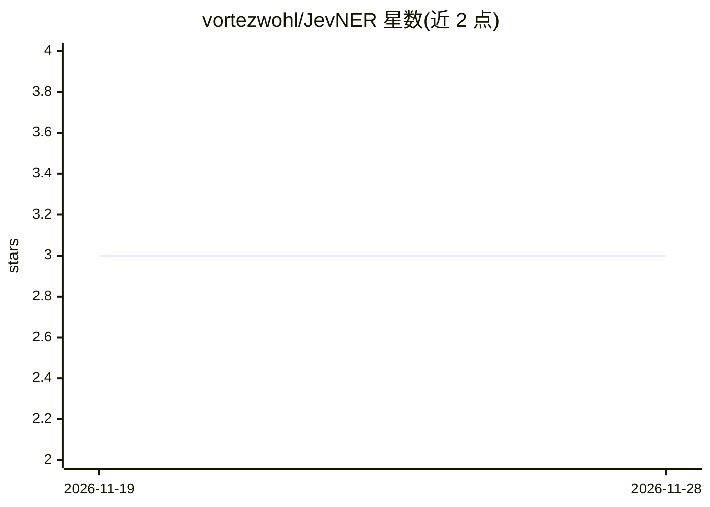

# vortezwohl/JevNER

⭐ 3 · Python · MIT · 推送 2026-11-05 · [GitHub](https://github.com/vortezwohl/JevNER) · 个人维护

**零样本多语言命名实体识别 Python SDK，输出嵌套实体树**

将 System One 判断模型（返回校准概率而非生成文本）封装为 NER 流水线的 Python SDK：识别结果以嵌套实体森林返回，偏移量满足 text==source[start:end]；实体类型可通过 JSON 文档在运行时扩展（31 个内置类型与 4 个垂直包）；内置 Qwen3 分词器，不含本地模型，全部推理经 EasyJev 网关完成，需 TYPESAFE_API_KEY 凭据；支持 24 种语言验证覆盖、多人格类型排序、性别判断与三层 LRU 缓存。明确不提供本地推理、托管、微调与标注工具。

## 筛选速览

| 维度 | 判定 | 备注 |
|---|---|---|
| AI 角色 | `ai-native` | 本体是模型或模型工具 |
| 许可风险 | `permissive` | MIT |
| 部署形态 | `library` | 以包/库形式分发 |
| 模型依赖 | — | README 未给出锁定关系 |
| 硬件要求 | — | 无带数字的原话,不猜 |
| 安装摩擦 | `low` | 无编译、无系统依赖或容器化 |
| 成熟度 | — | 结构信号不足 |

## 能力要点

- 零样本识别：无需训练/标注/微调，JSON 定义实体类型即可调用
- 返回值为嵌套实体树，嵌套结构由源文本偏移量派生
- 24 种语言覆盖，内置 Qwen3 分词器（100+ 语言）
- 校准概率支持按阈值路由人工复核

## 适用场景

- 从多语言文本中抽取人名/地名/机构等实体并保留嵌套层级
- 生物医学、金融、科技领域的垂直实体抽取
- 按置信度阈值把低分实体送入人工复核流程

## 场景标签

 · 领域:自然语言处理/信息抽取

## 证据(README 行号)

> L28: JevNER takes a third path. A **System One judgment model** — not a text generator — reads every question and return
> L79: |Zero-shot recognition|No training, no annotation, no fine-tuning. Define what to extract and start calling.|

## 星数曲线

2026-11-19 3 → 2026-11-28 3（+0）

---
*卡片 v1 · prompt 1.4 · 生成 2026-11-21 · 置信度 high · 依据 README sha `526a37828955` · [字段定义](../../DATASET.md)*
