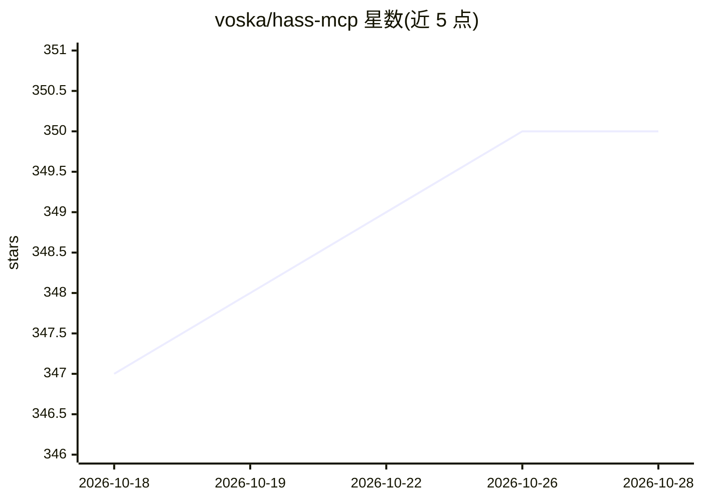

# voska/hass-mcp

⭐ 350 · Python · MIT · 推送 2026-10-24 · [GitHub](https://github.com/voska/hass-mcp) · 个人维护

**让 Claude 等 LLM 控制 Home Assistant 的 MCP 服务器**

面向智能家居用户的 Model Context Protocol (MCP) 服务器：通过 Home Assistant 的 REST/WebSocket API，使 Claude Desktop、Cursor、Claude Code 等 MCP 客户端能够查询设备与传感器状态、控制灯光开关、列出与操作自动化、读取错误日志与历史/统计数据，并实时编辑 Lovelace 仪表盘（带自动备份与 dry-run 预览）。提供 Docker 镜像与 uvx 两种运行方式，支持 stdio 与 streamable HTTP 传输（HTTP 模式无内置鉴权，需自行置于反向代理/VPN 之后），另附引导式对话 prompts 用于创建与排查自动化。

## 筛选速览

| 维度 | 判定 | 备注 |
|---|---|---|
| AI 角色 | `ai-ecosystem` | LLM/agent 周边工具 |
| 许可风险 | `permissive` | MIT |
| 部署形态 | `self-host` | docker 或自建部署 |
| 模型依赖 | locked-api |  |
| 硬件要求 | — | 无带数字的原话,不猜 |
| 安装摩擦 | `low` | 无编译、无系统依赖或容器化 |
| 成熟度 | — | 结构信号不足 |

## 能力要点

- 实体查询/控制/搜索、自动化管理、HA 服务调用与重启
- 通过 WebSocket API 实时编辑 Lovelace 仪表盘，保存前自动备份并支持 dry_run 预览
- 支持 stdio 与 streamable HTTP 传输，可多客户端共享部署
- 错误日志在服务端按 level/integration/关键词过滤以节省上下文

## 适用场景

- 用 Claude Desktop 对话式查询和控制家里的设备与传感器
- 让 AI 助手排查自动化失败原因并读取 HA 错误日志
- 通过对话修改 Lovelace 仪表盘卡片与视图
- 查看实体的历史状态与长期统计趋势

## 场景标签

 · 领域:智能家居/AI 工具接入

## 证据(README 行号)

> L5: A Model Context Protocol (MCP) server for Home Assistant integration with Claude and other LLMs.
> L13: Hass-MCP enables AI assistants like Claude to interact directly with your Home Assistant instance, allowing them to

## 星数曲线

2026-10-18 347 → 2026-10-28 350（+3）

---
*卡片 v1 · prompt 1.4 · 生成 2026-10-21 · 置信度 high · 依据 README sha `a3f60b349ccb` · [字段定义](../../DATASET.md)*
