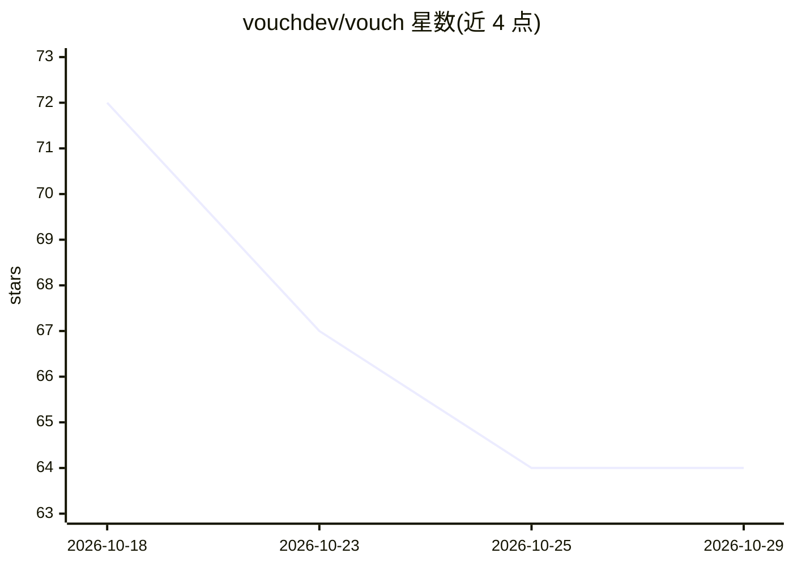

# vouchdev/vouch

⭐ 64 · Python · MIT · 推送 2026-08-23 · [GitHub](https://github.com/vouchdev/vouch) · [官网](https://vouchai.dev) · 组织维护

**面向 LLM agent 的 git 原生、审核门控知识库（MCP + CLI）**

vouch 以 MCP server、JSONL tool server 与 CLI 形式提供 LLM agent 的持久记忆层：会话自动捕获工具调用并汇总为待审提案，写入须经人工审核；批准后的产物为 .vouch/ 目录下的 YAML 声明与 markdown 页面，随 git 克隆流转，可像代码一样 diff 与评审。每条声明需引用内容哈希来源，未引用即校验错误；变更通过 supersede/contradict/archive 处理并保留历史，附 append-only 审计日志。vouch compile 可由 LLM 起草带引用的主题页，引用经机器校验后同样过审。与 Claude Code 深度集成（install-mcp 自动配置钩子与 MCP 工具）。

## 筛选速览

| 维度 | 判定 | 备注 |
|---|---|---|
| AI 角色 | `ai-ecosystem` | LLM/agent 周边工具 |
| 许可风险 | `permissive` | MIT |
| 部署形态 | `self-host` | docker 或自建部署 |
| 模型依赖 | — | README 未给出锁定关系 |
| 硬件要求 | — | 无带数字的原话,不猜 |
| 安装摩擦 | `low` | 无编译、无系统依赖或容器化 |
| 成熟度 | — | 结构信号不足 |

## 能力要点

- agent 提议写入、人工审核的 review gate 机制
- 产物为仓库内普通文件，git 原生、可 diff、随 clone 流转
- 每条声明引用内容哈希来源，未引用为校验错误
- vouch compile 由 LLM 起草带机器校验引用的 wiki 页面

## 适用场景

- 多 agent 或团队共用知识库时审计每条知识的来源与决定人
- 让 Claude Code 会话跨会话记忆并基于已审核知识回答
- 把项目知识编译成带验证引用的可维护 wiki

## 场景标签

`知识库管理` `Agent 记忆` · 领域:Agent 开发

## 证据(README 行号)

> L5: **Git-native, review-gated knowledge base for LLM agents. MCP server + JSONL tool server + CLI.**
> L16: `vouch` gives LLM agents durable memory with an explicit **review gate**: sessions capture themselves, agents *prop

## 星数曲线

2026-10-18 72 → 2026-10-29 64（-8）

---
*卡片 v1 · prompt 1.4 · 生成 2026-10-24 · 置信度 high · 依据 README sha `b6d0bc576c43` · [字段定义](../../DATASET.md)*
