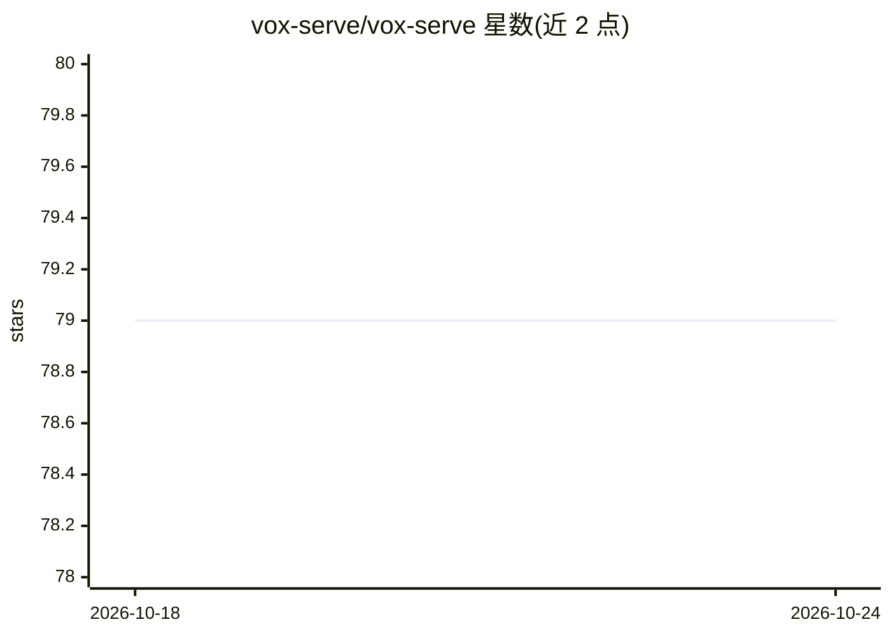

# vox-serve/vox-serve

⭐ 79 · Python · Apache-2.0 · 推送 2026-06-20 · [GitHub](https://github.com/vox-serve/vox-serve) · [官网](https://vox-serve.github.io/) · 组织维护 · 中文 README

**面向 TTS/STS 语音模型的流式推理服务引擎**

为语音语言模型（SpeechLM）提供低延迟、高吞吐的推理服务系统，覆盖文本转语音（TTS）与语音到语音（STS）两类模型。通过 pip 安装后以命令行启动服务，支持流式输出（demo 显示 H100 上 40ms 首音频延迟）；内置 8 个已支持模型（chatterbox、cosyvoice2、csm、orpheus、qwen3-tts、zonos、glm、step），提供 HTTP 接口、浏览器 Playground 与 LLM 集成的实时语音对话示例。有 arXiv 论文与文档。限制：模型列表仍在扩充中。

## 筛选速览

| 维度 | 判定 | 备注 |
|---|---|---|
| AI 角色 | `ai-ecosystem` | LLM/agent 周边工具 |
| 许可风险 | `permissive` | Apache-2.0 |
| 部署形态 | `library` | 以包/库形式分发 |
| 模型依赖 | — | README 未给出锁定关系 |
| 硬件要求 | — | 无带数字的原话,不猜 |
| 安装摩擦 | `low` | 无编译、无系统依赖或容器化 |
| 成熟度 | — | 结构信号不足 |

## 能力要点

- 流式（streaming-native）语音推理服务，支持 TTS/STS
- 支持 8 个模型：chatterbox/cosyvoice2/csm/orpheus/qwen3-tts/zonos/glm/step
- Qwen3-TTS 增量文本输入，可与本地 LLM 集成做语音对话
- 内置 Web Playground：管理服务、生成音频、查看实时日志

## 适用场景

- 把 TTS/STS 模型部署成可流式调用的推理服务
- 搭建低延迟语音聊天机器人（LLM + 语音合成）
- 在浏览器 Playground 中交互测试语音模型

## 场景标签

`语音合成` `推理引擎` · 领域:内容生成

## 证据(README 行号)

> L10: VoxServe delivers low-latency, high-throughput inference for Speech Language Models (SpeechLMs), including text-to-
> L48: VoxServe supports the following TTS and STS models:

## 星数曲线

2026-10-18 79 → 2026-10-24 79（+0）

---
*卡片 v1 · prompt 1.4 · 生成 2026-10-24 · 置信度 high · 依据 README sha `b972e79b6fed` · [字段定义](../../DATASET.md)*
