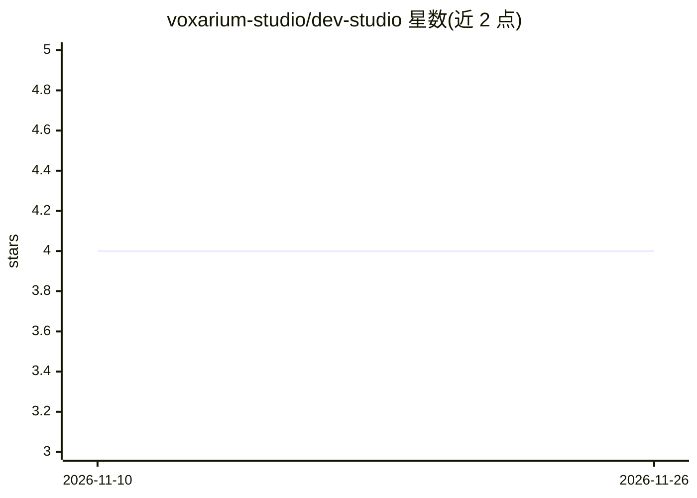

# voxarium-studio/dev-studio

⭐ 4 · Python · 推送 2026-11-23 · [GitHub](https://github.com/voxarium-studio/dev-studio) · [官网](https://voxarium.studio/studio/) · 组织维护 · 中文 README

**面向游戏开发的 AI Agent 工作区管理工具**

一个用于 AI 辅助游戏开发的本地工作区：构建流水线、管理 Claude Code 与 Codex agent 团队、浏览项目文件，并支持插件扩展。提供英文/俄文双语的 Web UI 与 Windows 桌面应用；项目状态存储在项目目录的 .voxarium_studio/ 中；可通过共享的 Voxarium Studio Remote（Docker 运行）实现多人文档协同编辑。运行 agent 与插件代码使用当前用户权限，远程访问需 token 与 HTTPS 反向代理。

## 筛选速览

| 维度 | 判定 | 备注 |
|---|---|---|
| AI 角色 | `ai-ecosystem` | LLM/agent 周边工具 |
| 许可风险 | `none` | — |
| 部署形态 | `desktop` | 安装包/桌面程序 |
| 模型依赖 | — | README 未给出锁定关系 |
| 硬件要求 | — | 无带数字的原话,不猜 |
| 安装摩擦 | `low` | 无编译、无系统依赖或容器化 |
| 成熟度 | — | 结构信号不足 |

## 能力要点

- 管理 Claude Code 与 Codex agent 团队
- 提供 Windows 安装器与跨平台 Web UI（英文/俄文）
- 通过 Voxarium Studio Remote（Docker）实现多人协同文档编辑
- 支持插件扩展 Studio

## 适用场景

- 在游戏项目中组织多个 AI agent 协作完成任务
- 团队多人协同编辑项目文档
- 为游戏开发搭建本地 agent 工作区并扩展插件

## 场景标签

`编码 Agent` `多智能体` `知识库管理` · 领域:Agent 开发

## 证据(README 行号)

> L3: Local workspace for AI-assisted game development. Build pipelines, manage teams of
> L4: Claude Code and Codex agents, browse project files and extend the Studio with plugins.

## 星数曲线

2026-11-10 4 → 2026-11-26 4（+0）

---
*卡片 v1 · prompt 1.4 · 生成 2026-11-21 · 置信度 mid · 依据 README sha `a2a240b71c45` · [字段定义](../../DATASET.md)*
