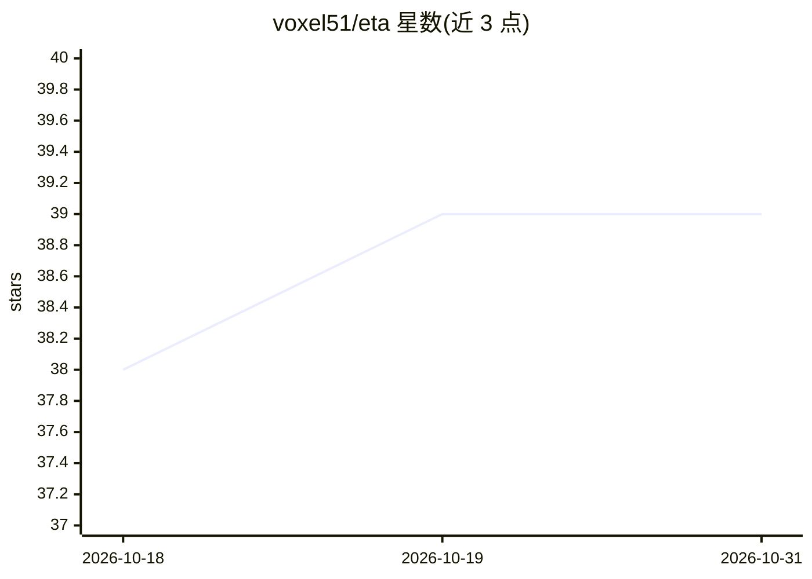

# voxel51/eta

⭐ 39 · Python · Apache-2.0 · 推送 2026-09-23 · [GitHub](https://github.com/voxel51/eta) · [官网](https://voxel51.com) · 组织维护

**面向计算机视觉与视频分析的开源工具库与流水线基础设施**

ETA 是一个可扩展的计算机视觉、机器学习与视频分析工具库：核心包提供图像、视频、嵌入等处理工具，另含分类器、检测器、语义分割器的推理封装，以及模型注册、视频分析模块与流水线构建和运行机制。安装支持 pip 轻量安装或源码脚本安装（含 lite/developer 模式），可选依赖（如 ffmpeg、TensorFlow）在需要时提示安装；支持 TensorFlow 1.X/2.X、CPU 与 GPU 环境，并提供 eta CLI 与示例目录。由 Voxel51 维护，曾获 NIST 公共安全创新加速器项目支持。

## 筛选速览

| 维度 | 判定 | 备注 |
|---|---|---|
| AI 角色 | `ai-native` | 本体是模型或模型工具 |
| 许可风险 | `permissive` | Apache-2.0 |
| 部署形态 | `library` | 以包/库形式分发 |
| 模型依赖 | — | README 未给出锁定关系 |
| 硬件要求 | `cpu-ok` | |
| 安装摩擦 | `medium` | 含编译或系统依赖之一 |
| 成熟度 | — | 结构信号不足 |

## 能力要点

- 分类器/检测器/分割器推理封装与模型注册表
- 视频分析模块与流水线构建、运行机制
- pip 轻量安装，可选依赖按需提示安装
- 提供 eta CLI：构建运行流水线、下载模型、交互远程存储

## 适用场景

- 搭建视频分析流水线并运行检测/分类/分割模型
- 管理 ML 模型库并按需下载使用
- 在 Mac/Linux 上做图像与视频批处理分析

## 场景标签

`图像视频处理` `目标检测` · 领域:感知与多模态

## 证据(README 行号)

> L3: **An open and extensible computer vision, machine learning and video analytics
> L168: |`eta/classifiers`|wrappers for performing inference with common classifiers|
> L170: |`eta/detectors`|wrappers for performing inference with common detectors|

## 星数曲线

2026-10-18 38 → 2026-10-31 39（+1）

---
*卡片 v1 · prompt 1.4 · 生成 2026-10-25 · 置信度 mid · 依据 README sha `e371542cd6b8` · [字段定义](../../DATASET.md)*
