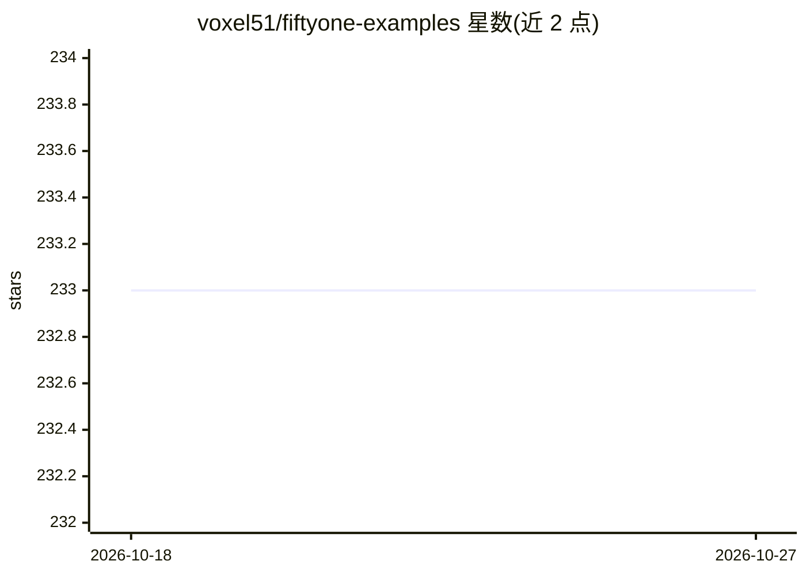

# voxel51/fiftyone-examples

⭐ 233 · Python · Apache-2.0 · 推送 2026-03-23 · [GitHub](https://github.com/voxel51/fiftyone-examples) · [官网](https://fiftyone.ai) · 组织维护

**FiftyOne 使用示例集：Jupyter Notebook 演示数据集与模型分析**

Voxel51 维护的 FiftyOne 官方示例仓库：以 Jupyter Notebook 形式提供 quickstart、walkthrough 及各类任务示例，包括用 OpenVINO 优化版 Segment Anything 添加对象掩码、在 COCO 上对比 YOLOv4 与 EfficientDet、查找检测数据集错误、深度伪造检测评估、情绪识别分析、图像唯一性分析等。每个示例可在 Google Colab 免配置运行，也可本地运行（git clone 后用 jupyter notebook 打开）。面向计算机视觉与机器学习开发者。

## 筛选速览

| 维度 | 判定 | 备注 |
|---|---|---|
| AI 角色 | `ai-knowledge` | 知识聚合/清单类 |
| 许可风险 | `permissive` | Apache-2.0 |
| 部署形态 | `self-host` | docker 或自建部署 |
| 模型依赖 | — | README 未给出锁定关系 |
| 硬件要求 | — | 无带数字的原话,不猜 |
| 安装摩擦 | `low` | 无编译、无系统依赖或容器化 |
| 成熟度 | — | 结构信号不足 |

## 能力要点

- 示例均以 Jupyter Notebook 提供，支持 Colab 免配置运行
- 覆盖模型对比、数据清洗、数据集错误查找、深度伪造检测等任务
- 本地运行方式：git clone 后用 jupyter notebook 打开

## 适用场景

- 快速上手 FiftyOne 的数据集可视化与模型分析工作流
- 参考如何在数据集中查找标注错误与清洗数据
- 学习如何将 Segment Anything 等模型的输出接入 FiftyOne 数据集

## 场景标签

`模型评测` · 领域:评测与运维

## 证据(README 行号)

> L3: # **Examples**
> L162: Each example in this repository is provided as a
> L163: Jupyter Notebook. The table of contents below provides
> L164: handy links for each example:

## 星数曲线

2026-10-18 233 → 2026-10-27 233（+0）

---
*卡片 v1 · prompt 1.4 · 生成 2026-10-22 · 置信度 mid · 依据 README sha `319795735721` · [字段定义](../../DATASET.md)*
