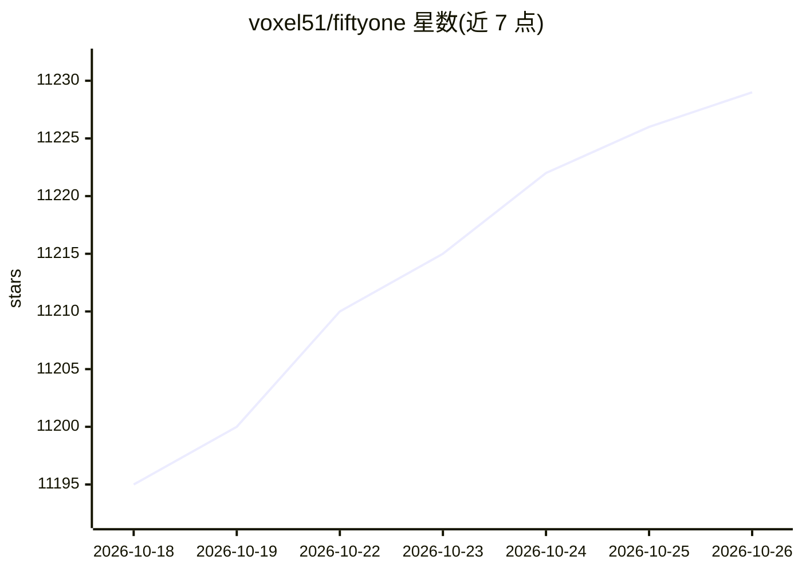

# voxel51/fiftyone

⭐ 11,229 · TypeScript · Apache-2.0 · 推送 2026-10-23 · [GitHub](https://github.com/voxel51/fiftyone) · [官网](https://fiftyone.ai) · 组织维护

**面向计算机视觉的数据集构建与模型评估工具**

开源 Python 工具，用于可视化、标注和管理图像/视频数据集，创建与编辑 2D/3D 标签，探索嵌入向量，评估模型表现并定位失败模式，发现并修正数据与标注问题。提供 FiftyOne App 图形界面与 Dataset Zoo、Model Zoo 等资源，可与 PyTorch、Hugging Face、Ultralytics 等库集成。安装方式为 pip，源码构建需 Python 3.10-3.13、Node.js 与 Yarn；公司另提供云端协作版 Voxel51。

## 筛选速览

| 维度 | 判定 | 备注 |
|---|---|---|
| AI 角色 | `ai-ecosystem` | LLM/agent 周边工具 |
| 许可风险 | `permissive` | Apache-2.0 |
| 部署形态 | `self-host` | docker 或自建部署 |
| 模型依赖 | — | README 未给出锁定关系 |
| 硬件要求 | — | 无带数字的原话,不猜 |
| 安装摩擦 | `low` | 无编译、无系统依赖或容器化 |
| 成熟度 | — | 结构信号不足 |

## 能力要点

- App 内原生创建与编辑 2D/3D 标签，支持接入外部标注工具
- 可视化探索图像、视频数据集与嵌入向量
- 模型评估、失败模式定位与数据问题修正
- 与 PyTorch、Hugging Face、Ultralytics 等深度学习库集成

## 适用场景

- 构建和清洗计算机视觉训练数据集
- 在可视化界面中做数据标注与 QA
- 评估模型表现并分析失败案例
- 通过嵌入视图发现标注错误与边缘样本

## 场景标签

`模型评测` · 领域:评测与运维

## 证据(README 行号)

> L30: We created **FiftyOne** to supercharge your visual AI
> L31: development by enabling you to visualize and label your data, evaluate your
> L32: models, and maximize data and model quality more efficiently than ever before
> L375: - **Analyze and Improve Models:**
> L376:  Evaluate model performance, identify failure modes, and fine-tune your

## 星数曲线

2026-10-18 11,195 → 2026-10-26 11,229（+34）

---
*卡片 v1 · prompt 1.4 · 生成 2026-10-20 · 置信度 high · 依据 README sha `9442e71a3de0` · [字段定义](../../DATASET.md)*
