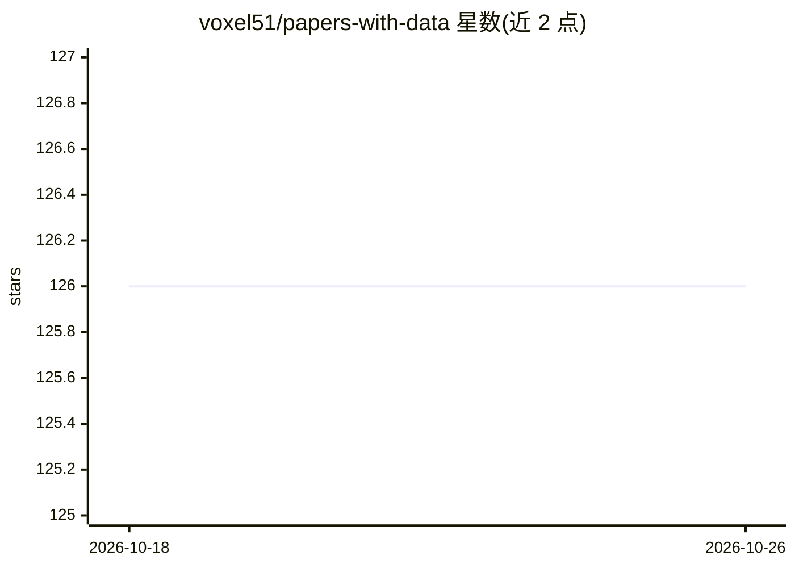

# voxel51/papers-with-data

⭐ 126 · Python · Apache-2.0 · 推送 2026-03-23 · [GitHub](https://github.com/voxel51/papers-with-data) · 组织维护

**随论文发布数据集的策展清单（NeurIPS/CVPR 等）**

Voxel51 维护的论文策展清单：从 NeurIPS 2023（2384 篇）、CVPR 2023（2359 篇）等会议接收论文中筛选随工作发布数据集的论文，并延伸覆盖 WACV 2024、ICCV 2023、2022 年论文与经典数据集。条目以表格列出标题、标签、论文链接（arXiv）、数据集（FiftyOne 格式）与代码链接，接受社区通过 issue/PR 补充。

## 筛选速览

| 维度 | 判定 | 备注 |
|---|---|---|
| AI 角色 | `ai-knowledge` | 知识聚合/清单类 |
| 许可风险 | `permissive` | Apache-2.0 |
| 部署形态 | `None` |  |
| 模型依赖 | — | README 未给出锁定关系 |
| 硬件要求 | — | 无带数字的原话,不猜 |
| 安装摩擦 | `low` | 无编译、无系统依赖或容器化 |
| 成熟度 | — | 结构信号不足 |

## 能力要点

- 筛选 NeurIPS 2023 2384 篇、CVPR 2023 2359 篇中发布数据集的论文
- 按会议/年份分节：WACV 2024、ICCV 2023、2022、经典数据集
- 条目含标签、arXiv 链接、FiftyOne 数据集链接与代码链接

## 适用场景

- 为机器学习项目查找高质量公开数据集
- 了解顶会中发布数据集的论文
- 按标签定位特定领域（医疗影像、遥感、跟踪等）的数据集

## 场景标签

`精选清单` · 领域:学习与行业

## 证据(README 行号)

> L22: We've combed through the **2384** papers accepted to NeurIPS in 2023 and compiled
> L25: |**Title**|**Tags**|**Paper**|**Dataset**|**Code**|

## 星数曲线

2026-10-18 126 → 2026-10-26 126（+0）

---
*卡片 v1 · prompt 1.4 · 生成 2026-10-23 · 置信度 high · 依据 README sha `da83f16927f7` · [字段定义](../../DATASET.md)*
