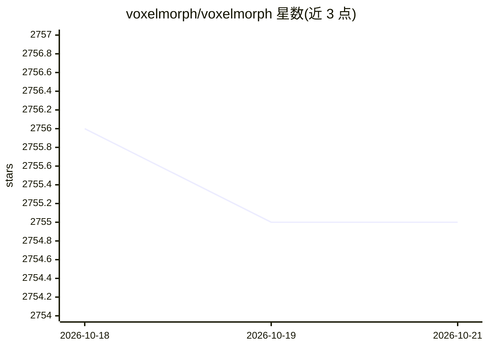

# voxelmorph/voxelmorph

⭐ 2,755 · Python · Apache-2.0 · 推送 2026-09-11 · [GitHub](https://github.com/voxelmorph/voxelmorph) · 组织维护

**面向医学影像配准的学习库，供研究者训练/运行形变配准模型**

VoxelMorph 是基于学习的图像对齐/配准通用库，核心为无监督学习的形变配准网络（CVPR/MICCAI 版本），支持微分同胚速度场积分、仿射与稠密形变、概率配准、模板（图谱）构建，以及无需真实数据的 SynthMorph 训练策略。提供预训练模型、register.py 两图配准脚本、Dice 测试脚本与多个教程。数据支持 NIfTI/MGZ/npz 格式。当前主分支为 PyTorch 开发版，接口可能变动，稳定 TensorFlow 版本在 dev-tensorflow 分支。以 pip 包与源码方式提供，面向影像研究与开发者。

## 筛选速览

| 维度 | 判定 | 备注 |
|---|---|---|
| AI 角色 | `ai-native` | 本体是模型或模型工具 |
| 许可风险 | `permissive` | Apache-2.0 |
| 部署形态 | `library` | 以包/库形式分发 |
| 模型依赖 | — | README 未给出锁定关系 |
| 硬件要求 | — | 无带数字的原话,不猜 |
| 安装摩擦 | `low` | 无编译、无系统依赖或容器化 |
| 成熟度 | `idea` | |

## 能力要点

- 无监督学习形变图像配准（CVPR/MICCAI 网络）
- SynthMorph：无需采集数据即可训练配准网络
- 提供预训练模型、训练/配准/Dice 测试脚本
- 支持 N 维仿射与稠密形变、微分同胚积分与模板构建

## 适用场景

- 配准两张医学影像并输出变形后图像与形变场
- 在自己的数据集上训练影像配准网络
- 构建无条件/条件可变形图谱（模板）
- 跨模态（CT 到 MRI）配准

## 场景标签

`模型训练` `图像视频处理` · 领域:感知与多模态

## 证据(README 行号)

> L3: **VoxelMorph** is a general purpose library for learning-based tools for alignment/registration, and more generally 
> L66: If you would like to train your own model, you will likely need to customize some of the data-loading code in `voxe
> L81: ./scripts/tf/register.py --moving moving.nii.gz --fixed atlas.nii.gz --moved warped.nii.gz --model model.h5 --gpu 0

## 星数曲线

2026-10-18 2,756 → 2026-10-21 2,755（-1）

---
*卡片 v1 · prompt 1.4 · 生成 2026-10-21 · 置信度 high · 依据 README sha `2b3f9329edc9` · [字段定义](../../DATASET.md)*
