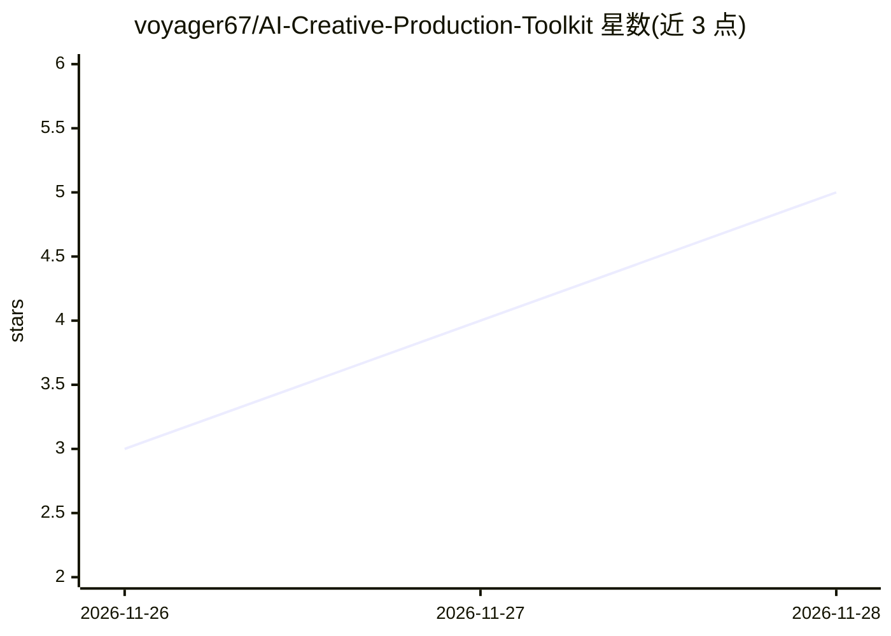

# voyager67/AI-Creative-Production-Toolkit

⭐ 5 · Python · Apache-2.0 · 推送 2026-11-22 · [GitHub](https://github.com/voyager67/AI-Creative-Production-Toolkit) · [官网](https://voyager67.github.io/AI-Creative-Production-Toolkit/) · 个人维护

**给创作者的 219 个 AI agent 技能与本地媒体工具包**

由两部分组成：一是以 SKILL.md 格式组织的 219 个 agent 技能库，为兼容的 AI agent 提供覆盖图像、视频、音频、3D、游戏美术等创意生产流程的结构化工作流；二是 asg 命令行工具，提供资产入库、SHA-256 清单、去重、图像处理、媒体转换、ComfyUI 请求与 Blender 场景检查等本地操作。设计上 local-first，不绑定特定模型提供方，外部创意应用（Blender、ComfyUI 等）需自行安装配置；成本估算依赖用户维护的费率表。

## 筛选速览

| 维度 | 判定 | 备注 |
|---|---|---|
| AI 角色 | `ai-ecosystem` | LLM/agent 周边工具 |
| 许可风险 | `permissive` | Apache-2.0 |
| 部署形态 | `library` | 以包/库形式分发 |
| 模型依赖 | — | README 未给出锁定关系 |
| 硬件要求 | — | 无带数字的原话,不猜 |
| 安装摩擦 | `medium` | 含编译或系统依赖之一 |
| 成熟度 | — | 结构信号不足 |

## 能力要点

- 219 个以 SKILL.md 格式组织的可移植 agent 技能，覆盖图像/视频/音频/3D 流程
- asg CLI 提供资产入库、哈希清单、去重、图像与媒体本地操作
- 支持向本地 ComfyUI 实例提交工作流并做 Blender 场景审计
- 无遥测、无后台同步，远程端点需显式 --allow-remote 授权

## 适用场景

- 为兼容的 AI agent 安装创意生产领域的工作流技能
- 整理参考资料库并生成 SHA-256 资产清单与去重
- 通过 CLI 向本地 ComfyUI 提交生成任务并做成本估算
- 交付前对图像、音频、3D 产出做校验检查

## 场景标签

`图像生成` `图像视频处理` · 领域:内容生成

## 证据(README 行号)

> L22: - **Agent skills** — focused, reusable `SKILL.md` workflows that give compatible AI agents structured procedures, p
> L23: - **Python toolkit** — the `asg` command-line interface for practical local operations such as asset intake, hashin

## 星数曲线

2026-11-26 3 → 2026-11-28 5（+2）

---
*卡片 v1 · prompt 1.4 · 生成 2026-11-26 · 置信度 mid · 依据 README sha `d8cc929ab70d` · [字段定义](../../DATASET.md)*
