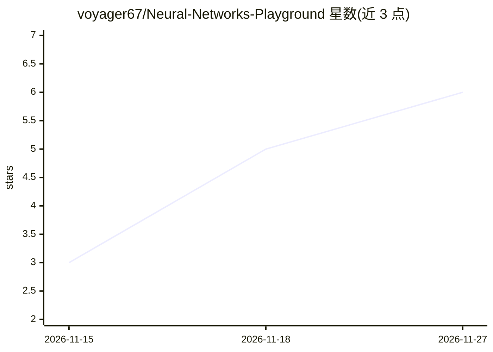

# voyager67/Neural-Networks-Playground

⭐ 6 · JavaScript · MIT · 推送 2026-11-05 · [GitHub](https://github.com/voyager67/Neural-Networks-Playground) · [官网](https://voyager67.github.io/Neural-Networks-Playground/) · 个人维护

**在浏览器中训练小型 MLP 并可视化权重、梯度与决策边界的教学实验台**

一个可视化优先的机器学习学习环境：用户在浏览器中训练 2D 二分类 MLP（1–4 个隐藏层，每层 2–32 单元），实时观察决策边界、损失曲线与训练准确率，点击神经元查看激活值、偏置、权重与小批量梯度，并可在同一合成数据集上对比 SGD/Momentum/Adam 与 Tanh/ReLU 等配置。全部计算由本地无依赖 JavaScript 引擎完成，无需 API key 与云端模型；另提供 NumPy + Matplotlib 的 CLI 实验轨，输出 JSON/CSV/PNG 结果。内置学习指南与数学推导文档，并声明训练指标不代表泛化性能。

## 筛选速览

| 维度 | 判定 | 备注 |
|---|---|---|
| AI 角色 | `ai-knowledge` | 知识聚合/清单类 |
| 许可风险 | `permissive` | MIT |
| 部署形态 | `library` | 以包/库形式分发 |
| 模型依赖 | — | README 未给出锁定关系 |
| 硬件要求 | — | 无带数字的原话,不猜 |
| 安装摩擦 | `low` | 无编译、无系统依赖或容器化 |
| 成熟度 | — | 结构信号不足 |

## 能力要点

- 浏览器内训练 MLP，实时可视化决策边界、权重、激活与梯度
- 同一数据集上对比多种优化器与激活函数配置并导出 CSV
- 无依赖 JavaScript 引擎 + NumPy 参考实现双轨，本地计算无需 API key
- 模型 JSON 导出/导入，合成数据集可控样本数、噪声与种子

## 适用场景

- 学习神经网络训练机制时观察决策边界随训练变化
- 课堂上演示优化器与激活函数对训练结果的影响
- 用 NumPy CLI 做可复现的小型分类实验并导出图表
- 调试和理解反向传播与梯度更新过程

## 场景标签

`教程课程` `模型训练` · 领域:学习与行业

## 证据(README 行号)

> L20: Most introductions to neural networks give you equations or a black-box training call. Neural Playground connects t
> L85: |**Learning guide**|Concepts, equations, glossary, model contract, optimiser notes, and reproducibility advice|
> L169: Built for learners who want to understand the mechanics behind neural-network training. The screenshot shows the l

## 星数曲线

2026-11-15 3 → 2026-11-27 6（+3）

---
*卡片 v1 · prompt 1.4 · 生成 2026-11-21 · 置信度 mid · 依据 README sha `8e597c2d1736` · [字段定义](../../DATASET.md)*
