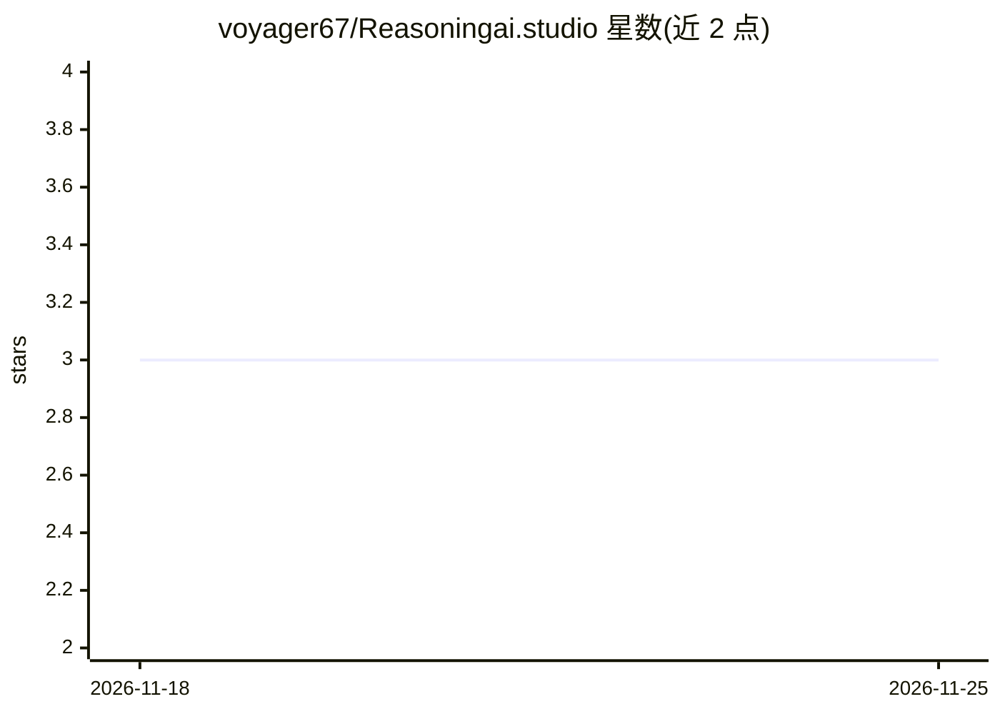

# voyager67/Reasoningai.studio

⭐ 3 · Python · NOASSERTION · 推送 2026-11-10 · [GitHub](https://github.com/voyager67/Reasoningai.studio) · 个人维护

**面向 AI agent 与科研人员的循证研究技能包：64 个技能覆盖科研全流程**

一个以证据为先的研究工具包，包含 64 个独立英文 agent 技能（34 个 ReasoningAI workflow + 30 个 ResearchForge Skills）、12 个可复用英文提示词、研究模板与本地 Python 工具。技能覆盖问题构建、文献检索、证据评估、实验设计、机器学习结果审计、论文写作与同行评审回应。本地工具仅用 Python 标准库，无第三方运行时依赖；网络请求仅在用户显式调用学术元数据查询时发生。技能在兼容的 AI 助手中通过打开 SKILL.md 使用。

## 筛选速览

| 维度 | 判定 | 备注 |
|---|---|---|
| AI 角色 | `ai-knowledge` | 知识聚合/清单类 |
| 许可风险 | `none` | NOASSERTION |
| 部署形态 | `library` | 以包/库形式分发 |
| 模型依赖 | — | README 未给出锁定关系 |
| 硬件要求 | — | 无带数字的原话,不猜 |
| 安装摩擦 | `low` | 无编译、无系统依赖或容器化 |
| 成熟度 | — | 结构信号不足 |

## 能力要点

- 64 个带输入/步骤/输出定义的独立 agent 技能，CC BY 4.0 许可
- 本地 Python 工具：BibTeX 审计、DOI 查询、PRISMA 计数、SHA-256 清单、密钥模式扫描
- 仅需 Python 3.10+，无运行时第三方包
- 附合成示例与自动化测试，无需私有研究数据即可验证

## 适用场景

- 用 AI 助手按技能执行系统综述与文献筛选
- 审计论文中的声明与证据对应关系
- 做可复现性预检与数据集审计
- 准备论文写作与同行评审回复材料

## 场景标签

`科研工具` · 领域:学习与行业

## 证据(README 行号)

> L5: An evidence-first research toolkit for AI agents and human researchers: 64 focused skills, 12 reusable prompts, prac
> L11: ReasoningAI Studio brings research tasks into one coherent, inspectable workflow. Its 64 standalone English-languag
> L37: To use a skill, open `skills/<skill-name>/SKILL.md` in a compatible AI assistant. Start with the skill catalog and 

## 星数曲线

2026-11-18 3 → 2026-11-25 3（+0）

---
*卡片 v1 · prompt 1.4 · 生成 2026-11-21 · 置信度 high · 依据 README sha `45bc85efca4a` · [字段定义](../../DATASET.md)*
