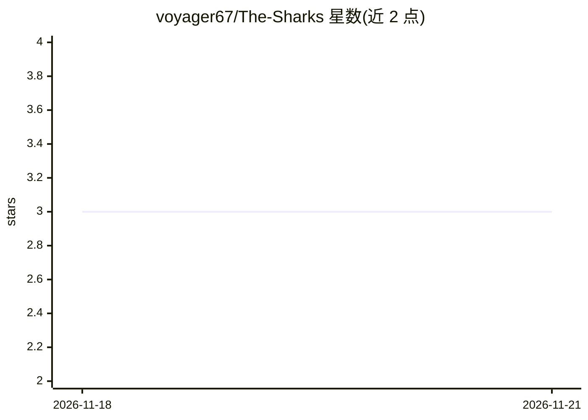

# voyager67/The-Sharks

⭐ 3 · Python · MIT · 推送 2026-11-12 · [GitHub](https://github.com/voyager67/The-Sharks) · 个人维护

**五专家 agent 创业评估框架：质询商业模式并给出修复清单**

一个多 agent 创业项目评估框架，由一个编排器与五个专家 agent（收入、客户、数字、竞争、创始人）组成，按六步循环运行：陈述→质询→各自给出带证据的 IN/OUT 判定与信念分→综合为 Deal Meter、KILL SHOT 与排序的修复清单→重陈。核心以开放的 Agent Skills（SKILL.md）约定编写，模型指令与宿主适配分离，可在支持原生子 agent 的宿主独立运行，其他宿主以指令方式使用。以 MIT 许可发布。

## 筛选速览

| 维度 | 判定 | 备注 |
|---|---|---|
| AI 角色 | `ai-native` | 本体是模型或模型工具 |
| 许可风险 | `permissive` | MIT |
| 部署形态 | `None` |  |
| 模型依赖 | — | README 未给出锁定关系 |
| 硬件要求 | — | 无带数字的原话,不猜 |
| 安装摩擦 | `low` | 无编译、无系统依赖或容器化 |
| 成熟度 | — | 结构信号不足 |

## 能力要点

- 五专家 agent 攻击不同失败面，编排器合成 Deal Meter 与 KILL SHOT
- 核心采用 SKILL.md 开放约定，模型无关、可跨宿主移植
- 证据规则：区分 FACT/ASSUMPTION/UNKNOWN，禁编造市场数据
- 输出含排序修复清单与低成本实验及通过阈值

## 适用场景

- 创业者融资前对商业模式做多角度压力测试
- 孵化器/加速器用结构化流程质询团队假设
- 投资人复评项目的关键假设与薄弱点

## 场景标签

`多智能体` · 领域:Agent 开发

## 证据(README 行号)

> L18: **The Sharks is a multi-agent startup evaluation framework built to challenge the business before customers, compet
> L36: Each Shark has its own specialist skill and standalone agent prompt. The master skill coordinates the panel; hosts 
> L85: The core is written in the open **Agent Skills** convention (`SKILL.md`) and keeps model instructions separate from

## 星数曲线

2026-11-18 3 → 2026-11-21 3（+0）

---
*卡片 v1 · prompt 1.4 · 生成 2026-11-21 · 置信度 high · 依据 README sha `d6a93779ff3f` · [字段定义](../../DATASET.md)*
