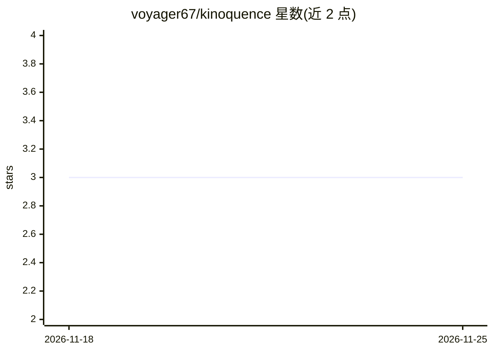

# voyager67/kinoquence

⭐ 3 · Python · MIT · 推送 2026-11-11 · [GitHub](https://github.com/voyager67/kinoquence) · [官网](https://voyager67.github.io/kinoquence/) · 个人维护

**面向创作者的本地优先 AI 动画短片制作工具包**

提供可移植的项目格式与一组本地 CLI 工具，将模型辅助的创意想法转化为结构化、可审阅的短片项目：JSON 分镜（含时间轴、旁白、字幕、镜头方向）、程序化音频、SRT 字幕、资产登记与署名生成，并用 FFmpeg/ffprobe 做技术 QA。用户可自选模型，API key 存于本地 .env。1.0.0-rc.3 为公开候选版本：Python 工作流经 53 项测试验证，Remotion 渲染链路端到端未验证。

## 筛选速览

| 维度 | 判定 | 备注 |
|---|---|---|
| AI 角色 | `ai-native` | 本体是模型或模型工具 |
| 许可风险 | `permissive` | MIT |
| 部署形态 | `library` | 以包/库形式分发 |
| 模型依赖 | — | README 未给出锁定关系 |
| 硬件要求 | — | 无带数字的原话,不猜 |
| 安装摩擦 | `medium` | 含编译或系统依赖之一 |
| 成熟度 | `idea` | |

## 能力要点

- 提供 OpenAI、Anthropic、Gemini、xAI 的 API 适配器及 OpenAI 兼容端点与本地推理服务器
- JSON 分镜带时间轴、旁白、字幕与校验，项目文件夹可编辑
- FFmpeg/ffprobe 检查、QA 报告与来源-声明映射
- Python CLI + Remotion 渲染器源码、程序化音频与 SRT 字幕生成

## 适用场景

- 把故事点子变成结构化动画短片分镜与字幕
- 用自选模型生成草稿，本地保留项目与凭据
- 对生成的视频做技术 QA 与出处核查

## 场景标签

`视频生成` · 领域:内容生成

## 证据(README 行号)

> L7: **A local-first, model-agnostic workflow for AI-assisted animated shorts.**
> L27: |**Model choice**|API adapters for OpenAI, Anthropic, Google Gemini and xAI, plus supported OpenAI-compatible endpo
> L31: |**Quality and provenance**|FFmpeg/ffprobe checks, QA reports and source-to-claim mapping for human review|

## 星数曲线

2026-11-18 3 → 2026-11-25 3（+0）

---
*卡片 v1 · prompt 1.4 · 生成 2026-11-22 · 置信度 high · 依据 README sha `16cbd38fd7c0` · [字段定义](../../DATASET.md)*
