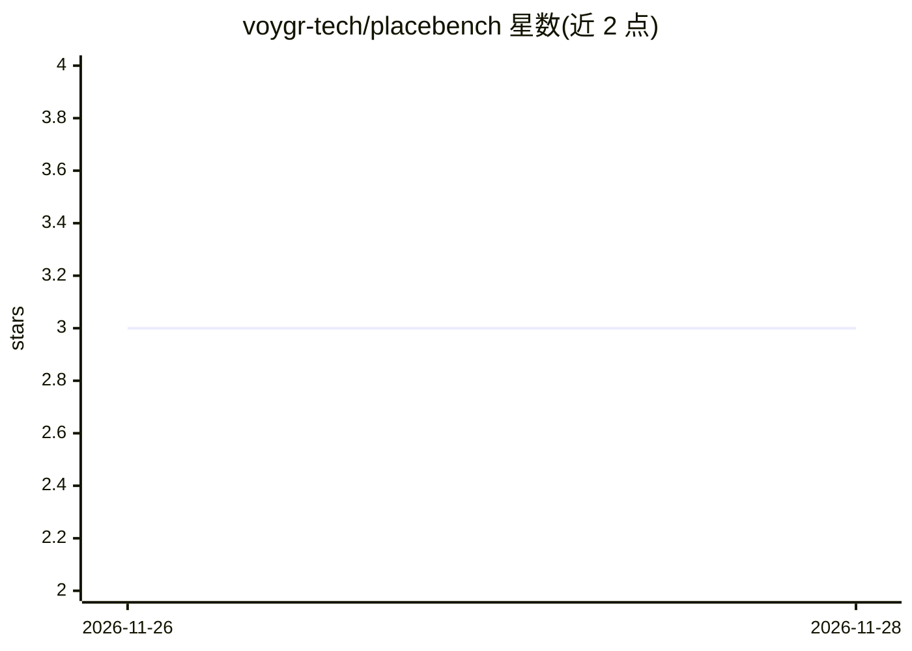

# voygr-tech/placebench

⭐ 3 · CC-BY-4.0 · 推送 2026-11-18 · [GitHub](https://github.com/voygr-tech/placebench) · [官网](https://voygr.tech/placebench) · 组织维护

**150 道真实地点日常问题的 AI 助手评测基准数据集**

PlaceBench 是一个评测数据集与结果发布：围绕 121 个城市的 150 道带日期时间的日常地点问题（附近找店、路线规划、预订联系等），每题附经来源核验的标准答案（answer key），来源优先级为商户官网、运营方时刻表、Google Maps 列表及 OpenStreetMap 等公开资料。六个 AI 助手各答全部题目，提供 900 条首答与 240 条重复回答的逐条评分（grades.jsonl），评分由 Claude 模型判分并经人工校准与交叉复核，含计分规则、置信区间、局限性说明与引用条目，内容以 CC BY 4.0 发布。

## 筛选速览

| 维度 | 判定 | 备注 |
|---|---|---|
| AI 角色 | `ai-knowledge` | 知识聚合/清单类 |
| 许可风险 | `viral` | CC-BY-4.0 |
| 部署形态 | `None` |  |
| 模型依赖 | — | README 未给出锁定关系 |
| 硬件要求 | — | 无带数字的原话,不猜 |
| 安装摩擦 | `low` | 无编译、无系统依赖或容器化 |
| 成熟度 | — | 结构信号不足 |

## 能力要点

- 150 道题、121 个城市，每题附可核验的答案键与来源链接
- 46 题以城市本地语言撰写，多数指定具体日期时间以便核验
- 完整公开逐条评分数据（900 首答 + 240 重复），可复算分数
- LLM 判分经人工校准并用另一模型交叉复核

## 适用场景

- 复算或复现六款 AI 助手在地点类问题上的评测分数
- 以此为模板构建带答案键的领域评测集
- 研究地点类问答中 LLM 判分的校准与交叉复核方法

## 场景标签

`模型评测` · 领域:评测与运维

## 证据(README 行号)

> L37: |`data/questions.jsonl`|The 150 questions: id, kind, city, country, language, stated day and time, the question as 
> L39: |`data/grades.jsonl`|Every grade: question, assistant, try (1 to 3) and grade. 900 first answers, plus the 240 repe
> L94: Claude Opus 5.5 grades each first answer against its key, and we hand-verified places to calibrate it. As a cross-c

## 星数曲线

2026-11-26 3 → 2026-11-28 3（+0）

---
*卡片 v1 · prompt 1.4 · 生成 2026-11-26 · 置信度 high · 依据 README sha `45bdb92326bf` · [字段定义](../../DATASET.md)*
