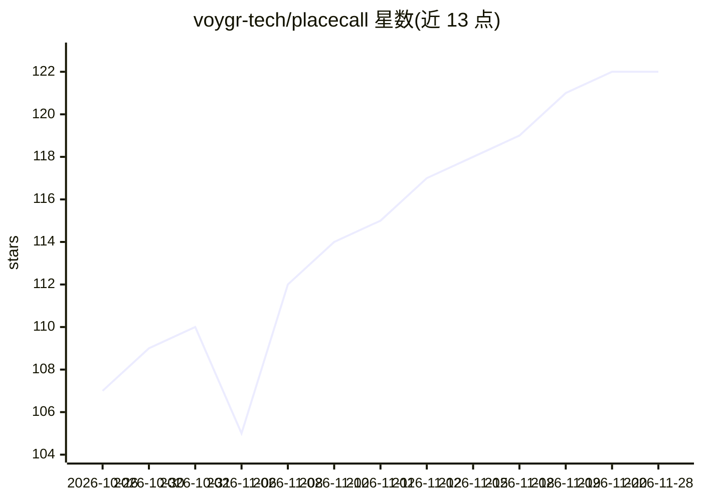

# voygr-tech/placecall

⭐ 122 · Shell · MIT · 推送 2026-11-25 · [GitHub](https://github.com/voygr-tech/placecall) · [官网](https://voygr.tech/placecall/) · 组织维护

**让 AI agent 打电话给美国商家完成预订、询价与核实**

PlaceCall 是一个电话呼叫 API 与 agent 集成层：给 agent 一个美国商家号码和一段英文任务简报，它拨号、应对 IVR 与等待、与商家通话，返回标注的呼叫结果、完整转录与录音，失败时附原因（挂断/占线/语音信箱/错号）。无号码时可描述地点，由其查找候选并撰写简报。接入方式覆盖 Claude Code 插件与 skill、claude.ai 连接器、ChatGPT/Codex 插件目录、通用 MCP 客户端及 Hermes Agent；支持浏览器 OAuth 登录或 API key，前 250 通电话免费，由前 Google Maps/Search 开发者创办的 Voygr Tech 维护。

## 筛选速览

| 维度 | 判定 | 备注 |
|---|---|---|
| AI 角色 | `ai-ecosystem` | LLM/agent 周边工具 |
| 许可风险 | `permissive` | MIT |
| 部署形态 | `None` |  |
| 模型依赖 | — | README 未给出锁定关系 |
| 硬件要求 | — | 无带数字的原话,不猜 |
| 安装摩擦 | `low` | 无编译、无系统依赖或容器化 |
| 成熟度 | — | 结构信号不足 |

## 能力要点

- 电话呼叫 API：返回结果标签、完整转录与录音
- 无号码时按地点描述查找候选商家并生成通话简报
- 多客户端接入：Claude Code 插件、MCP server、ChatGPT/Codex 插件目录
- 前 250 通电话免费，浏览器登录即创建带免费额度的账户

## 适用场景

- 让 agent 替我打电话订餐厅或预约
- 批量向多家商家询价并拿回转录
- 核实订单状态、库存等电话信息

## 场景标签

`语音 Agent` · 领域:对话与助手

## 证据(README 行号)

> L3: PlaceCall lets your agent call US businesses to handle reservations, gather
> L52: MCP server (`https://api.voygr.tech/mcp`). You sign in once in a browser; the
> L186: Point the client at `https://api.voygr.tech/mcp` (streamable HTTP transport).

## 星数曲线

2026-10-26 107 → 2026-11-28 122（+15）

---
*卡片 v1 · prompt 1.4 · 生成 2026-11-28 · 置信度 high · 依据 README sha `97bcf9a657b7` · [字段定义](../../DATASET.md)*
