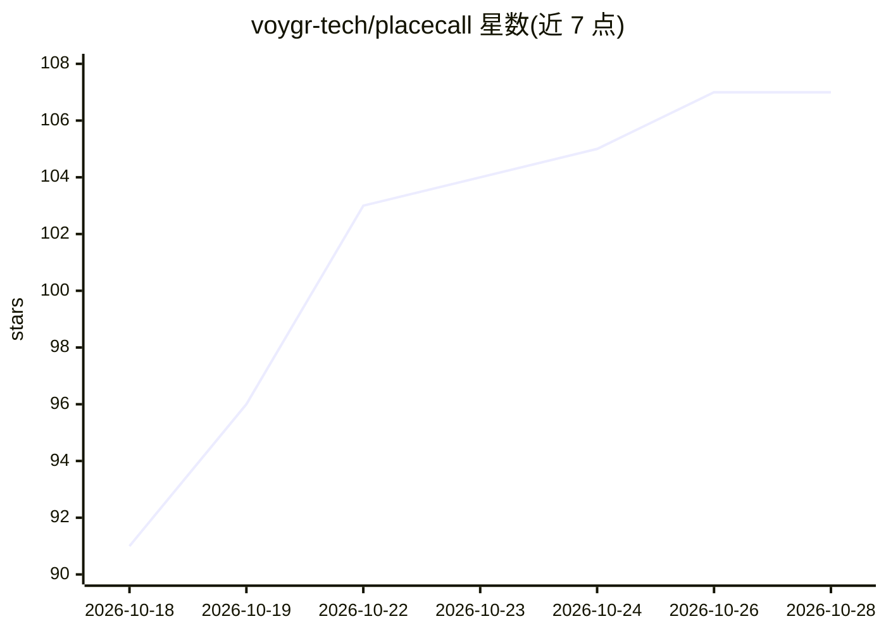

# voygr-tech/placecall

⭐ 107 · Shell · MIT · 推送 2026-10-28 · [GitHub](https://github.com/voygr-tech/placecall) · [官网](https://voygr.tech/placecall/) · 组织维护

**让 AI agent 电话致电美国商户的 API/MCP 服务，含通话结果与转录**

由 Voygr（前 Google Maps/Search 开发者）提供的电话呼叫服务：给定美国号码或场所描述与英文任务简报，系统自动拨号、应对 IVR 与等待、与商户对话，完成预订、询价、信息核实等任务，返回 17 种验证结果之一及完整转录与录音。接入方式包括 REST API（API key）、Claude Code/Codex/Cursor 插件、claude.ai 与 ChatGPT 连接器、Gemini CLI 扩展及任意 MCP 客户端，多为浏览器 OAuth 登录，首 250 次通话免费，此后按量计费。

## 筛选速览

| 维度 | 判定 | 备注 |
|---|---|---|
| AI 角色 | `ai-ecosystem` | LLM/agent 周边工具 |
| 许可风险 | `permissive` | MIT |
| 部署形态 | `None` |  |
| 模型依赖 | — | README 未给出锁定关系 |
| 硬件要求 | — | 无带数字的原话,不猜 |
| 安装摩擦 | `low` | 无编译、无系统依赖或容器化 |
| 成熟度 | — | 结构信号不足 |

## 能力要点

- 自动拨号并应对 IVR、等待与真人对话，处理预订/询价/核实等任务
- 每次通话返回 17 种验证结果之一，附完整转录与录音
- 无号码时可按场所描述查找候选并自动撰写通话简报
- 提供 Claude Code/Codex 插件、MCP 服务器、ChatGPT/claude.ai 连接器等多种接入途径

## 适用场景

- 让我的 agent 打电话给餐厅订位或改约
- 批量致电商户核实信息、跟进订单或询价
- 在 Claude Code 或 ChatGPT 里直接发起并追踪通话

## 场景标签

`语音 Agent` · 领域:对话与助手

## 证据(README 行号)

> L3: PlaceCall lets your agent call US businesses to handle reservations, gather
> L48: The Claude Code, Codex and Cursor plugins carry the skill and the PlaceCall
> L163: Point the client at `https://api.voygr.tech/mcp` (streamable HTTP transport).

## 星数曲线

2026-10-18 91 → 2026-10-28 107（+16）

---
*卡片 v1 · prompt 1.4 · 生成 2026-10-23 · 置信度 high · 依据 README sha `ca3b04ab4a39` · [字段定义](../../DATASET.md)*
