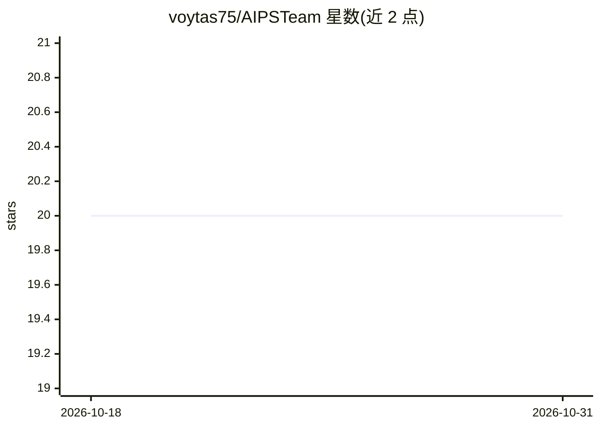

# voytas75/AIPSTeam

⭐ 20 · PowerShell · MIT · 推送 2026-03-27 · [GitHub](https://github.com/voytas75/AIPSTeam) · [官网](https://www.powershellgallery.com/packages/AIPSTeam) · 个人维护

**PowerShell 多智能体脚本：模拟交付团队产出代码/文档/评审草稿**

PowerShell 单脚本工具，围绕用户的项目想法或既有脚本模拟多角色 AI 团队（Manager/Developer/Documentator 等）按序协作，产出需求梳理、实现建议、PowerShell 代码、文档草稿与评审式反馈。支持 Azure OpenAI、Ollama、LM Studio 三种后端，可选 RAG 检索（SerpApi/EXA/Serper 网络搜索，按序回退）。通过 PowerShell Gallery 的 Install-Script 安装，依赖 PSAOAI/PSScriptAnalyzer/powerHTML 模块；官方说明首跑输出为工作草稿而非生产就绪交付物，Windows 为最顺路径，WSL/Linux 预期更多配置摩擦。

## 筛选速览

| 维度 | 判定 | 备注 |
|---|---|---|
| AI 角色 | `ai-native` | 本体是模型或模型工具 |
| 许可风险 | `permissive` | MIT |
| 部署形态 | `None` |  |
| 模型依赖 | local-ok | 支持本地模型 |
| 硬件要求 | — | 无带数字的原话,不猜 |
| 安装摩擦 | `low` | 无编译、无系统依赖或容器化 |
| 成熟度 | `idea` | |

## 能力要点

- 多角色（Manager→Developer→评审→文档）序列化协作流
- Azure OpenAI / Ollama / LM Studio 三后端可选
- RAG 检索支持 SerpApi/EXA/Serper 三家搜索源按序回退
- -TheCodePath 可直接在既有 PowerShell 脚本上改进/调试

## 适用场景

- 从一段自然语言描述生成结构化的 PowerShell 项目草稿
- 让 AI 团队改进、调试或扩写我已有的 PowerShell 脚本
- 在一份工作流里同时拿到代码、文档草稿和评审式反馈

## 场景标签

`多智能体` `代码生成` `AI 写作` · 领域:Agent 开发

## 证据(README 行号)

> L13: AIPSTeam is a PowerShell-first AI collaboration script that simulates a small delivery team around your project ide
> L183: This PowerShell script simulates a team of AI agents working together on a PowerShell project. Each specialist has
> L97: - generated PowerShell code or code fragments

## 星数曲线

2026-10-18 20 → 2026-10-31 20（+0）

---
*卡片 v1 · prompt 1.4 · 生成 2026-10-28 · 置信度 high · 依据 README sha `13f99c18b186` · [字段定义](../../DATASET.md)*
