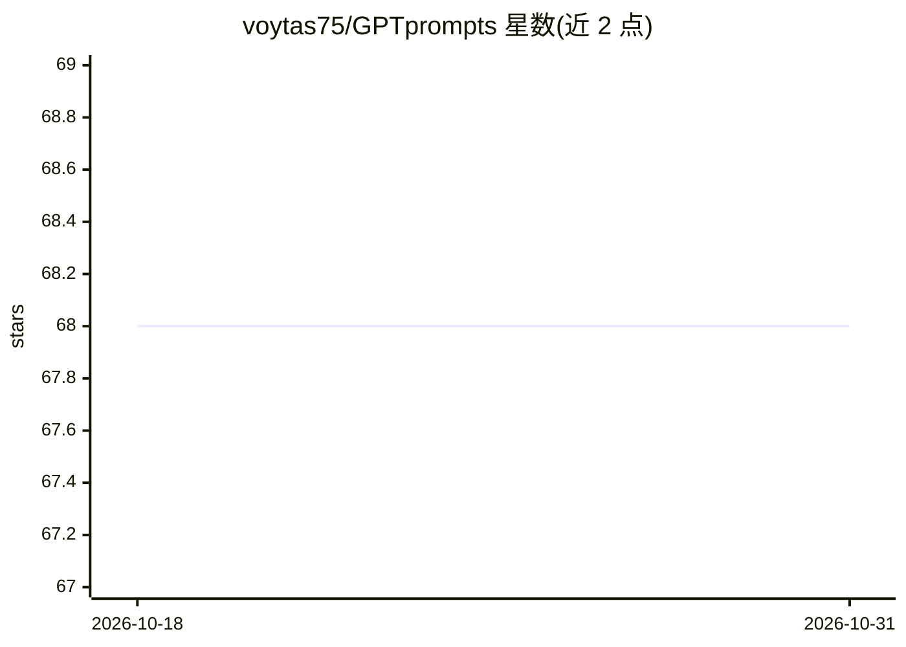

# voytas75/GPTprompts

⭐ 68 · MIT · 推送 2026-10-01 · [GitHub](https://github.com/voytas75/GPTprompts) · 个人维护

**面向 LLM 的提示词合集：按技术类型与学科分类编目**

一个提示词（prompt）集合仓库：前半部分按提示技术组织，收录 Chain-of-Thought、Line-of-Thought、Few-Shot、Self-Consistency、Meta Prompting、RAG 等类别的示例提示模板，以可直接复制的文本块形式给出；后半部分为提示词分类索引，按艺术人文、生物、商业经济、化学、计算机信息科学等学科列出 200 余条带编号的提示词条目。仓库另含一个 GPT-5 提示优化工具的介绍。无安装步骤，使用方式为查阅与复制提示文本。

## 筛选速览

| 维度 | 判定 | 备注 |
|---|---|---|
| AI 角色 | `ai-knowledge` | 知识聚合/清单类 |
| 许可风险 | `permissive` | MIT |
| 部署形态 | `None` |  |
| 模型依赖 | — | README 未给出锁定关系 |
| 硬件要求 | — | 无带数字的原话,不猜 |
| 安装摩擦 | `low` | 无编译、无系统依赖或容器化 |
| 成熟度 | — | 结构信号不足 |

## 能力要点

- 按 CoT/LoT/Few-Shot/Self-Consistency/RAG 等提示技术组织的模板
- 学科分类索引覆盖艺术人文、生物、商业、化学、计算机等领域的 200 余条提示词
- 含 GPT-5 提示优化工具的介绍章节

## 适用场景

- 查找可复用的提示工程技术模板
- 按学科领域浏览带编号的提示词条目
- 学习 Chain-of-Thought、Self-Consistency 等提示技术的示例写法

## 场景标签

`提示工程` · 领域:Agent 开发

## 证据(README 行号)

> L15: ## 2. Chain-of-Thought (CoT) Prompting
> L199: ## 8. Prompt's classification (new)
> L283:  1. Artificial Intelligence and Machine Learning.

## 星数曲线

2026-10-18 68 → 2026-10-31 68（+0）

---
*卡片 v1 · prompt 1.4 · 生成 2026-10-24 · 置信度 high · 依据 README sha `c8024e876422` · [字段定义](../../DATASET.md)*
