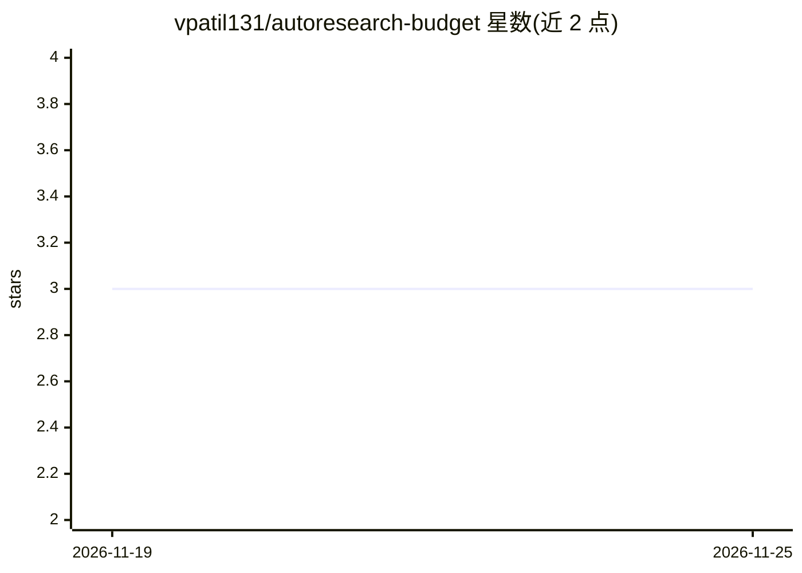

# vpatil131/autoresearch-budget

⭐ 3 · Python · MIT · 推送 2026-10-13 · [GitHub](https://github.com/vpatil131/autoresearch-budget) · 个人维护

**研究者用的实验框架：测试受限前沿指导对小编码 agent 的影响**

面向研究者的实验框架，用于研究小编码 agent 在边界化前沿模型指导下完成任务的行为：支持在独立、咨询、对照等条件下运行匹配实验，检查建议的执行情况，并以独立评分结果做对比。当前通过 Harbor 支持 SWE-rebench 基准（24 任务开发队列），付费推理经 OpenRouter 网关；离线检查、规划、报告与脚本演示无需凭证。需 Python 3.12+、macOS/Linux，实时执行另需 Docker 与 Compose；咨询运行不强制美元上限，仅记录成本与调用限制。

## 筛选速览

| 维度 | 判定 | 备注 |
|---|---|---|
| AI 角色 | `ai-ecosystem` | LLM/agent 周边工具 |
| 许可风险 | `permissive` | MIT |
| 部署形态 | `library` | 以包/库形式分发 |
| 模型依赖 | locked-api |  |
| 硬件要求 | — | 无带数字的原话,不猜 |
| 安装摩擦 | `low` | 无编译、无系统依赖或容器化 |
| 成熟度 | `idea` | |

## 能力要点

- 六种咨询策略 preset（定时/按请求/计划审查/恢复审查/混合/对照）
- 通过 Harbor 运行 SWE-rebench 任务包并独立评分
- report/compare 命令输出 JSON/CSV 报告与条件对比
- 离线演示无需 API key、Docker 或任务下载

## 适用场景

- 比较小编码 agent 在不同建议策略下的 SWE-rebench 得分
- 检查 agent 对顾问建议的采纳与执行情况
- 在本地离线环境验证与展示实验流程

## 场景标签

`模型评测` `科研工具` · 领域:评测与运维

## 证据(README 行号)

> L5: An experimental research harness for studying how a small coding actor uses bounded guidance from a frontier advisor
> L9: The supported paid workflow uses **OpenRouter** for actor and advisor inference. Model profiles select models and un

## 星数曲线

2026-11-19 3 → 2026-11-25 3（+0）

---
*卡片 v1 · prompt 1.4 · 生成 2026-11-21 · 置信度 high · 依据 README sha `88abd1c70694` · [字段定义](../../DATASET.md)*
