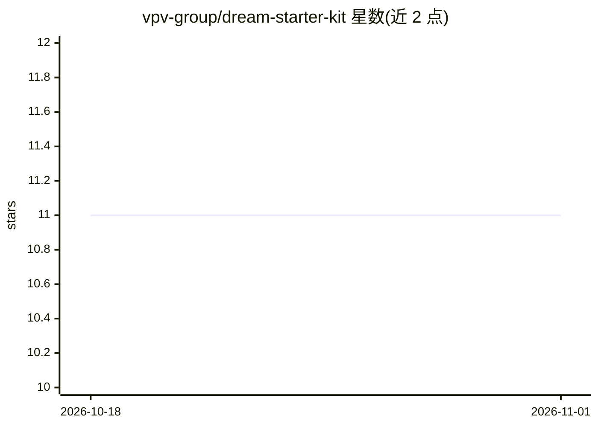

# vpv-group/dream-starter-kit

⭐ 11 · TypeScript · Apache-2.0 · 推送 2026-10-17 · [GitHub](https://github.com/vpv-group/dream-starter-kit) · [官网](https://meetdream.com/) · 组织维护

**全栈 Web+iOS/Android 应用起步模板：认证、CMS、支付、推送、AI 助手一体**

基于 Turborepo 的 monorepo 起步模板，包含 Next.js Web 应用与 Expo 移动应用，共享一个 Supabase 后端（Postgres、Auth、行级安全、Storage、Edge Functions）。预置 Payload CMS 内容后台、Stripe 订阅支付（单一 Pro 计划）、Expo 推送通知、提醒 CRUD 参考实现，以及经 Vercel AI Gateway 调用 Claude 的 AI 助手（带鉴权、限流、token 上限）和远程 MCP 服务器（OAuth 2.1、仅员工可用）。需 Node 22 + pnpm 10 + Supabase CLI + Docker 本地运行，一键部署到 Vercel；自述为 BETA。

## 筛选速览

| 维度 | 判定 | 备注 |
|---|---|---|
| AI 角色 | `ai-enhanced` | 去掉 AI 部分产品仍成立 |
| 许可风险 | `permissive` | Apache-2.0 |
| 部署形态 | `library` | 以包/库形式分发 |
| 模型依赖 | — | README 未给出锁定关系 |
| 硬件要求 | — | 无带数字的原话,不猜 |
| 安装摩擦 | `low` | 无编译、无系统依赖或容器化 |
| 成熟度 | `idea` | |

## 能力要点

- Web 与移动端共享一套 Supabase 后端与 react-query 数据层
- AI 助手经 Vercel AI Gateway 调用 Claude，模型 id 可在配置包中替换
- 远程 MCP 服务器支持 Claude/ChatGPT/Cursor 等客户端自然语言管理 CMS 与推送
- CI 中含类型检查、Vitest、RLS 隔离回归与 Playwright e2e 质量门禁

## 适用场景

- 克隆后快速搭建带认证和支付的 SaaS 产品
- 为内容型应用同时提供 Web 与 iOS/Android 客户端
- 通过 AI 编码助手按 CLAUDE.md 中的流程逐功能扩展代码库

## 场景标签

 · 领域:全栈应用开发/SaaS 模板

## 证据(README 行号)

> L37: - **AI assistant** — Vercel AI SDK v6 → Claude through the AI Gateway, behind an
> L41: - **A remote MCP server** — connect Claude, ChatGPT, Cursor, or any MCP client to

## 星数曲线

2026-10-18 11 → 2026-11-01 11（+0）

---
*卡片 v1 · prompt 1.4 · 生成 2026-11-01 · 置信度 mid · 依据 README sha `5a445ead1859` · [字段定义](../../DATASET.md)*
