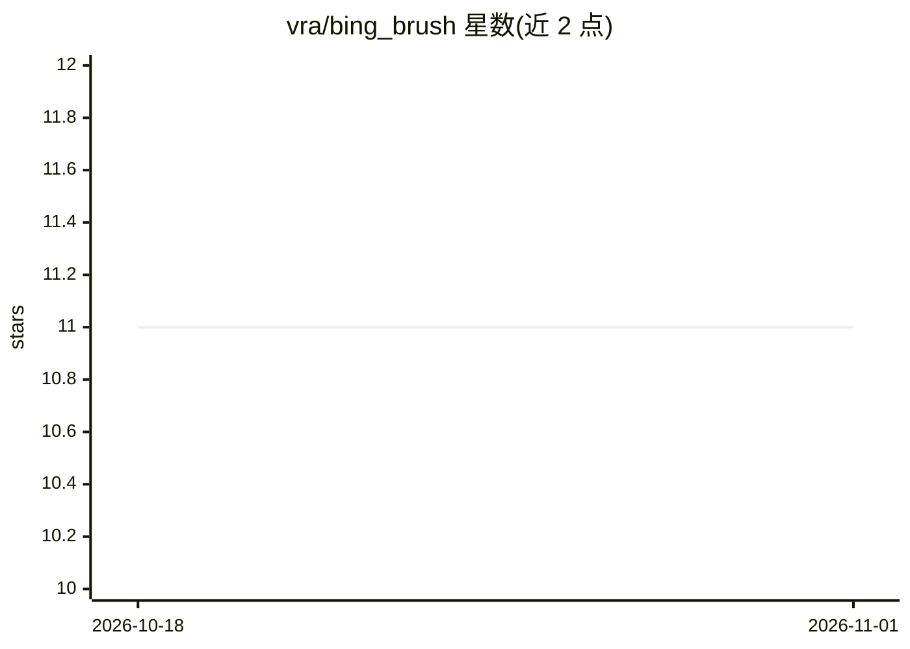

# vra/bing_brush

⭐ 11 · Python · 推送 2026-06-22 · [GitHub](https://github.com/vra/bing_brush) · [官网](https://bing-brush.vercel.app) · 个人维护

**调用 Bing Image Creator 的单行图像生成 Python 工具**

基于 Bing Image Creator（DALL·E 3）封装的图像生成程序，一行 pip 安装即可使用。用户需先登录 Bing.com 并从浏览器开发者工具复制 Cookie 保存为文件，之后通过 CLI（bing_brush -c cookie.txt -p 'prompt'）或 Python API 调用，每次生成 4 张图片到指定目录。调用方案源自 acheong08/BingImageCreator 项目。依赖 Bing Cookie 是使用前提，非官方 API 通道。

## 筛选速览

| 维度 | 判定 | 备注 |
|---|---|---|
| AI 角色 | `ai-native` | 本体是模型或模型工具 |
| 许可风险 | `none` | — |
| 部署形态 | `library` | 以包/库形式分发 |
| 模型依赖 | — | README 未给出锁定关系 |
| 硬件要求 | — | 无带数字的原话,不猜 |
| 安装摩擦 | `low` | 无编译、无系统依赖或容器化 |
| 成熟度 | — | 结构信号不足 |

## 能力要点

- 一行命令 pip install bing_brush 安装
- 提供 CLI 与 Python API 两种调用方式
- 基于 Bing Image Creator（DALL·E 3）生成图像，每次输出 4 张
- 通过本地 Cookie 文件鉴权访问 Bing.com

## 适用场景

- 我想在命令行里用一句话生成图片
- 我想在 Python 脚本中集成文本生成图像功能
- 我想利用 Bing 的 DALL·E 3 通道生成图像

## 场景标签

`图像生成` · 领域:内容生成

## 证据(README 行号)

> L1: ### One-line Image Generating Program Based on the Bing Image Createor (Powered by DALL·E 3)
> L31: bing_brush -c cookie.txt -p 'a cute panda eating bamboos' -o output_folder

## 星数曲线

2026-10-18 11 → 2026-11-01 11（+0）

---
*卡片 v1 · prompt 1.4 · 生成 2026-11-01 · 置信度 high · 依据 README sha `ecd13261232b` · [字段定义](../../DATASET.md)*
