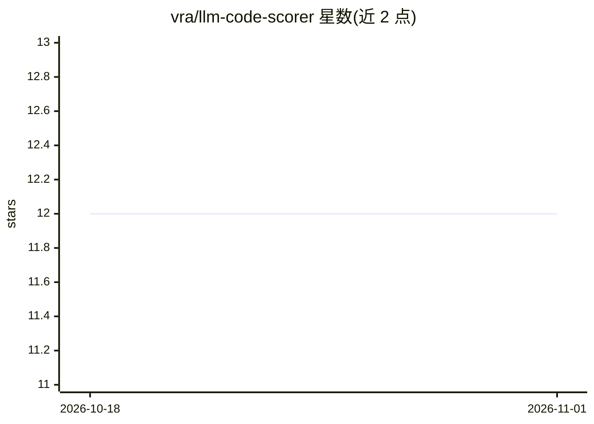

# vra/llm-code-scorer

⭐ 12 · Python · MIT · 推送 2026-06-22 · [GitHub](https://github.com/vra/llm-code-scorer) · [官网](http://lcs.simpleai.site) · 个人维护 · 中文 README

**用 LLM 对 GitHub 仓库代码打分的 Web 应用**

Flask+gunicorn 后端与 Vue 前端组成的网页应用：输入 GitHub 仓库地址后由智谱免费的 glm-4-flash 模型生成代码评分与理由，打分 prompt 设计在 ai_coder_scorer.py 中。README 声明的限制：大模型回复不固定，每次分值和理由会变化；超过 100M 的仓库不支持（国内下载慢）。通过 nvm/npm 搭建前端环境并 pip 安装 Python 依赖后运行，需提供智谱 API key。

## 筛选速览

| 维度 | 判定 | 备注 |
|---|---|---|
| AI 角色 | `ai-native` | 本体是模型或模型工具 |
| 许可风险 | `permissive` | MIT |
| 部署形态 | `library` | 以包/库形式分发 |
| 模型依赖 | — | README 未给出锁定关系 |
| 硬件要求 | — | 无带数字的原话,不猜 |
| 安装摩擦 | `low` | 无编译、无系统依赖或容器化 |
| 成熟度 | — | 结构信号不足 |

## 能力要点

- glm-4-flash 模型生成仓库评分与理由
- Flask + gunicorn 后端，Vue 前端
- 提供在线体验地址
- 国内环境使用 gitclone.com 镜像克隆仓库

## 适用场景

- 快速了解一个 GitHub 仓库的代码质量评分
- 对比模型给出的代码评价与改进理由

## 场景标签

`代码审查` · 领域:编码与开发

## 证据(README 行号)

> L2: 用 LLM 给 GitHub 代码仓库进行打分
> L7: 1. LLM：采用免费的智谱`glm-4-flash`模型

## 星数曲线

2026-10-18 12 → 2026-11-01 12（+0）

---
*卡片 v1 · prompt 1.4 · 生成 2026-10-31 · 置信度 mid · 依据 README sha `0370f2ca0336` · [字段定义](../../DATASET.md)*
