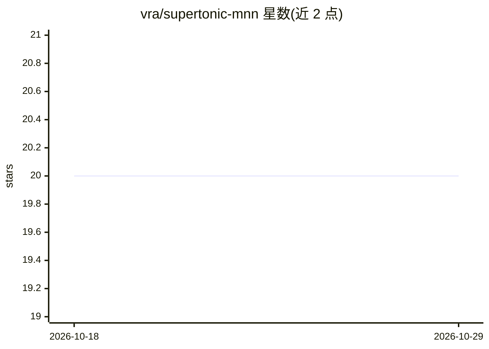

# vra/supertonic-mnn

⭐ 20 · Python · 推送 2026-06-22 · [GitHub](https://github.com/vra/supertonic-mnn) · [官网](https://vra.github.io/supertonic-mnn/) · 个人维护 · 中文 README

**基于 MNN 推理引擎的多语言 TTS 库，提供 CLI 与 Python API**

在 MNN 推理引擎上运行 Supertonic TTS 模型（v2 多语言、v3 支持 30+ 语言）的 Python 库，同时提供命令行接口。支持 fp32/fp16/int8 三种精度，10 种音色（M1-M5 男声、F1-F5 女声），README 标注 CPU 上 RTF 约 0.07。限制：需 Python 3.10（MNN 约束）。模型托管于 HuggingFace，另附 Gradio demo 与 Bilibili 演示视频。

## 筛选速览

| 维度 | 判定 | 备注 |
|---|---|---|
| AI 角色 | `ai-native` | 本体是模型或模型工具 |
| 许可风险 | `none` | — |
| 部署形态 | `library` | 以包/库形式分发 |
| 模型依赖 | — | README 未给出锁定关系 |
| 硬件要求 | — | 无带数字的原话,不猜 |
| 安装摩擦 | `low` | 无编译、无系统依赖或容器化 |
| 成熟度 | — | 结构信号不足 |

## 能力要点

- 支持 30+ 语言与语言无关模式
- fp32/fp16/int8 多精度选项
- 10 种音色（M1-M5 男声，F1-F5 女声）
- 同时提供 CLI 与 Python API

## 适用场景

- 在本地用 CLI 快速合成多语言语音
- 在 Python 应用中集成 TTS 能力
- 用 Gradio demo 试听不同语言与音色效果

## 场景标签

`语音合成` · 领域:内容生成

## 证据(README 行号)

> L11: **Supertonic MNN** is a high-performance, lightweight multilingual text-to-speech (TTS) library powered by MNN infe
> L83: **Supertonic MNN** 是一个基于 MNN 推理引擎的高性能、轻量级多语言文本转语音 (TTS) 库。支持 30+ 语言、10 种音色，同时提供命令行和 Python API。

## 星数曲线

2026-10-18 20 → 2026-10-29 20（+0）

---
*卡片 v1 · prompt 1.4 · 生成 2026-10-28 · 置信度 high · 依据 README sha `6b915dde1904` · [字段定义](../../DATASET.md)*
