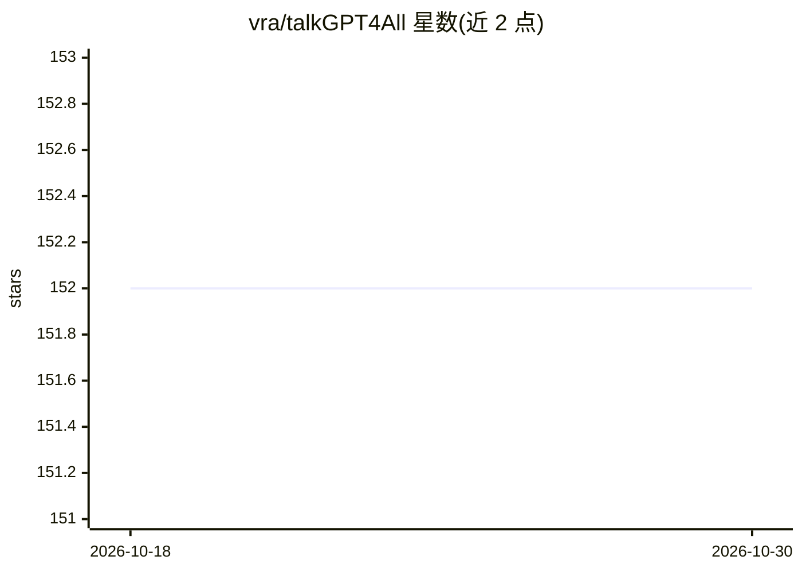

# vra/talkGPT4All

⭐ 152 · Python · MIT · 推送 2026-06-22 · [GitHub](https://github.com/vra/talkGPT4All) · 个人维护 · 中文 README

**本地运行语音聊天机器人：Whisper 听、GPT4All 答、pyttsx3 说**

基于 GPT4All 的本地语音对话工具：用 OpenAI Whisper 做语音识别，GPT4All 模型在本地生成回答，pyttsx3 将文本转为语音输出，全程在用户本机运行。支持通过命令行参数切换不同的 GPT4All ggml 模型与 Whisper 模型（tiny 到 large），并可调节语速。以 pip 包形式安装，Linux 用户需额外安装 espeak 等系统依赖；提供源码安装方式与视频演示，旧版本在 dev/v1.0.0 分支。

## 筛选速览

| 维度 | 判定 | 备注 |
|---|---|---|
| AI 角色 | `ai-native` | 本体是模型或模型工具 |
| 许可风险 | `permissive` | MIT |
| 部署形态 | `library` | 以包/库形式分发 |
| 模型依赖 | — | README 未给出锁定关系 |
| 硬件要求 | — | 无带数字的原话,不猜 |
| 安装摩擦 | `medium` | 含编译或系统依赖之一 |
| 成熟度 | — | 结构信号不足 |

## 能力要点

- Whisper 语音识别 + GPT4All 本地生成 + pyttsx3 语音合成
- 可切换多种 GPT4All ggml 模型与 Whisper 模型规格
- 命令行运行，支持 --voice-rate 调节语速

## 适用场景

- 在本机离线进行语音对话
- 尝试不同规模的 Whisper 与 GPT4All 模型组合
- 调节语音输出的语速适配个人偏好

## 场景标签

`语音 Agent` · 领域:对话与助手

## 证据(README 行号)

> L2: A voice chatbot based on GPT4All and talkGPT.
> L45: You can choose different LLMs using `--gpt-model-type <type>`, all available choices:
> L54: You can choose whisper model type using `--whisper-model-type <type>`, all available choices:

## 星数曲线

2026-10-18 152 → 2026-10-30 152（+0）

---
*卡片 v1 · prompt 1.4 · 生成 2026-10-22 · 置信度 high · 依据 README sha `a750c701c40c` · [字段定义](../../DATASET.md)*
