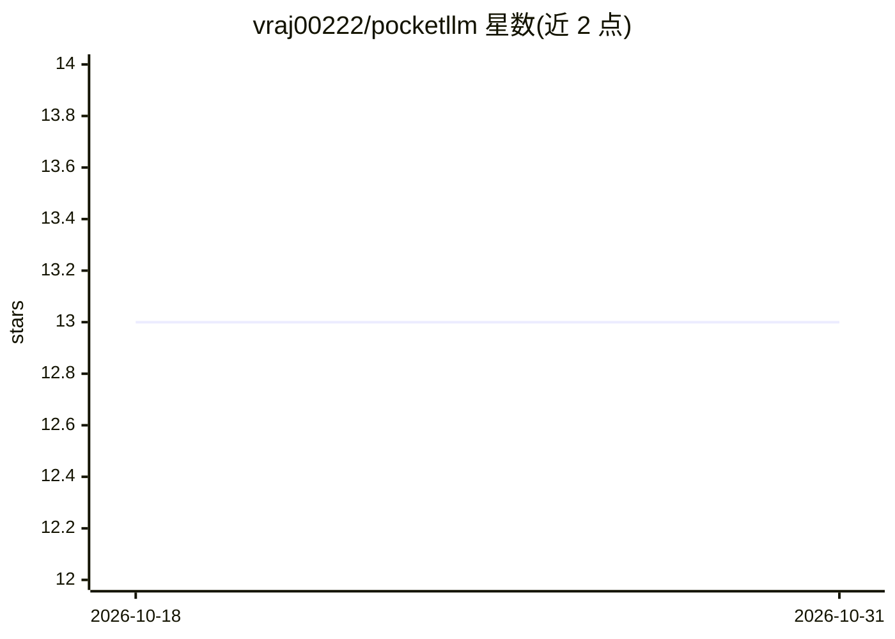

# vraj00222/pocketllm

⭐ 13 · HTML · 推送 2026-04-13 · [GitHub](https://github.com/vraj00222/pocketllm) · [官网](https://pocketllm-site.vercel.app/) · 个人维护

**U 盘便携本地 LLM 工具包：即插即用聊天、拔出无痕**

面向希望随身携带本地 AI 的用户：将 Ollama 运行时、模型权重、终端/网页聊天界面与会话历史全部打包到单个 U 盘。首次运行 setup.sh 下载运行时，日常只需一条 launch.sh 即可在任意 macOS/Linux 机器上启动本地聊天（网页 UI 在 localhost:8080），核心机制是通过 OLLAMA_MODELS 指向 U 盘存储，主机 CPU/GPU 负责推理。README 提供基准数据：U 盘冷加载比 SSD 慢 3-7 倍，加载后推理速度相同（gemma4:e2b 约 54 tok/s）。限制：主机仍需足够 RAM（7B 模型约 5-6GB）。

## 筛选速览

| 维度 | 判定 | 备注 |
|---|---|---|
| AI 角色 | `ai-native` | 本体是模型或模型工具 |
| 许可风险 | `none` | — |
| 部署形态 | `None` |  |
| 模型依赖 | local-ok | 支持本地模型 |
| 硬件要求 | — | 无带数字的原话,不猜 |
| 安装摩擦 | `low` | 无编译、无系统依赖或容器化 |
| 成熟度 | — | 结构信号不足 |

## 能力要点

- Ollama 运行时、模型、聊天 UI、会话历史全部封装于单个 U 盘
- 设置 OLLAMA_MODELS 指向 U 盘，主机零安装、拔出无残留
- 支持任意 Ollama 兼容模型（Gemma/Llama/Mistral/Phi 等）
- 支持 JavaScript 插件扩展聊天 UI（skills 机制）

## 适用场景

- 在多台机器间随身携带本地 LLM 而不在主机留下模型文件
- 希望 U 盘即插即聊、保护隐私零痕迹的本地 AI 使用
- 不想在主机安装 Ollama/Docker 的临时本地推理环境

## 场景标签

`聊天机器人` · 领域:对话与助手

## 证据(README 行号)

> L7: PocketLLM is a portable USB toolkit for running local LLMs. It bundles everything — the Ollama runtime, model weight
> L50: - **Web UI** — browser chat with markdown rendering, code blocks, conversation history

## 星数曲线

2026-10-18 13 → 2026-10-31 13（+0）

---
*卡片 v1 · prompt 1.4 · 生成 2026-10-31 · 置信度 high · 依据 README sha `0df0a48c4a62` · [字段定义](../../DATASET.md)*
