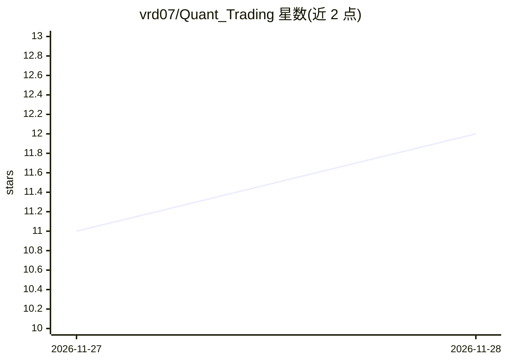

# vrd07/Quant_Trading

⭐ 12 · Python · MIT · 推送 2026-11-01 · [GitHub](https://github.com/vrd07/Quant_Trading) · 个人维护

**面向个人交易者的 XAUUSD/外汇/加密算法交易系统**

运行于 MetaTrader 5 的多策略自动交易系统，覆盖 XAUUSD、BTC、ETH、EUR/USD 等品种：13 个独立策略经 regime/品种/时段门控，订单须通过 16 项风险检查（熔断、日亏损预算、回撤、敞口等），每日用 RandomForest+马尔可夫链平滑的 regime 分类器重写策略权重。README 面向非技术用户给出 Windows/macOS 全流程安装指南，通过 EA 桥文件与 MT5 终端通信，声明在真实账户交易存在全额亏损风险。

## 筛选速览

| 维度 | 判定 | 备注 |
|---|---|---|
| AI 角色 | `ai-enhanced` | 去掉 AI 部分产品仍成立 |
| 许可风险 | `permissive` | MIT |
| 部署形态 | `desktop` | 安装包/桌面程序 |
| 模型依赖 | — | README 未给出锁定关系 |
| 硬件要求 | — | 无带数字的原话,不猜 |
| 安装摩擦 | `low` | 无编译、无系统依赖或容器化 |
| 成熟度 | — | 结构信号不足 |

## 能力要点

- 13 个 regime 门控策略，含 Kalman、VWAP 均值回归、SMC 订单块等
- 16 步风险引擎对每笔订单有绝对否决权，触发后需手动重置 kill switch
- 夜间运行的 ML regime 分类器按日重写策略权重
- 状态每 10 秒序列化到磁盘，支持断电恢复

## 适用场景

- 在 MetaTrader 5 上自动交易黄金与外汇
- 按 prop firm 的日亏损与回撤规则管理实盘风险
- 对策略做样本外回测与逐步审计

## 场景标签

`金融量化` · 领域:学习与行业

## 证据(README 行号)

> L17: - **A nightly ML regime classifier** (RandomForest + Markov chain smoother + RL-lite performance feedback) that rew
> L92: This is an **automated gold (XAUUSD) trading bot** built for the **The5ers $5,000 prop firm challenge**. It:
> L94: - Connects to MetaTrader 5 (MT5) on your PC or Mac

## 星数曲线

2026-11-27 11 → 2026-11-28 12（+1）

---
*卡片 v1 · prompt 1.4 · 生成 2026-11-27 · 置信度 low · 依据 README sha `843091867080` · [字段定义](../../DATASET.md)*
