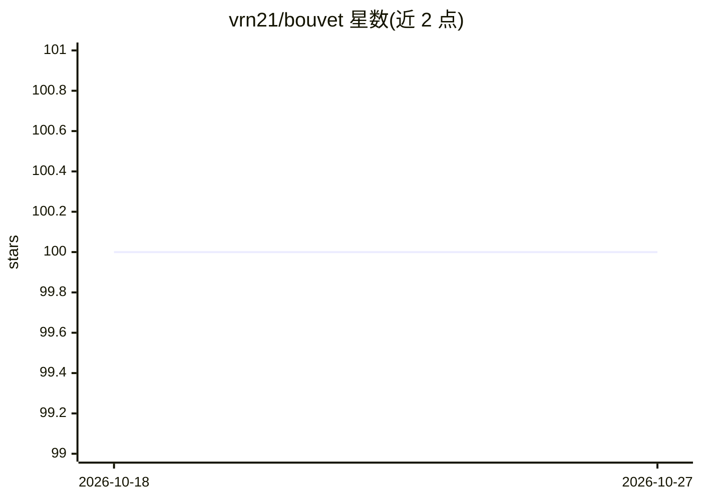

# vrn21/bouvet

⭐ 100 · Rust · MIT · 推送 2026-08-09 · [GitHub](https://github.com/vrn21/bouvet) · [官网](https://deepwiki.com/vrn21/bouvet) · 个人维护

**为 AI agent 提供隔离代码执行沙箱的 MCP 服务器**

基于 Firecracker microVM 的 MCP 服务器，为 AI agent 创建安全隔离的代码执行沙箱：agent 通过 MCP 工具创建沙箱、执行 Python/Node.js/Bash 代码、读写文件，用完即销毁。每个 microVM 约 256MB RAM、1 vCPU、1 秒内启动，具备独立内核与文件系统。面向使用 Claude、Cursor 等 MCP 兼容客户端构建 AI agent 的开发者，需自行托管部署。

## 筛选速览

| 维度 | 判定 | 备注 |
|---|---|---|
| AI 角色 | `ai-ecosystem` | LLM/agent 周边工具 |
| 许可风险 | `permissive` | MIT |
| 部署形态 | `None` |  |
| 模型依赖 | — | README 未给出锁定关系 |
| 硬件要求 | — | 无带数字的原话,不猜 |
| 安装摩擦 | `low` | 无编译、无系统依赖或容器化 |
| 成熟度 | — | 结构信号不足 |

## 能力要点

- Firecracker microVM 硬件级隔离（独立内核，非容器共享）
- 暖池机制实现 200ms 内沙箱创建
- 提供 9 个 MCP 工具（创建/销毁沙箱、执行代码、读写文件等）
- 预装 Python、Node.js 与常用开发工具的完整 Linux 环境

## 适用场景

- 让 AI agent 在隔离环境中安全执行不可信代码
- 为 Claude/Cursor 等 MCP 客户端接入沙箱化代码执行能力
- 替代容器方案获得更强的内核级隔离

## 场景标签

`Agent 框架` · 领域:Agent 开发

## 证据(README 行号)

> L19: Bouvet (boo-veh) is an MCP server that creates secure, isolated sandboxes for AI agents to execute code.
> L23: **The problem it solves:** AI agents need a safe place to run untrusted code. Docker isn't enough containers share 
> L25: **Who it's for:** Developers building AI agents with Claude, Cursor, or any MCP-compatible client who need secure c

## 星数曲线

2026-10-18 100 → 2026-10-27 100（+0）

---
*卡片 v1 · prompt 1.4 · 生成 2026-10-23 · 置信度 high · 依据 README sha `7b0e064c655e` · [字段定义](../../DATASET.md)*
