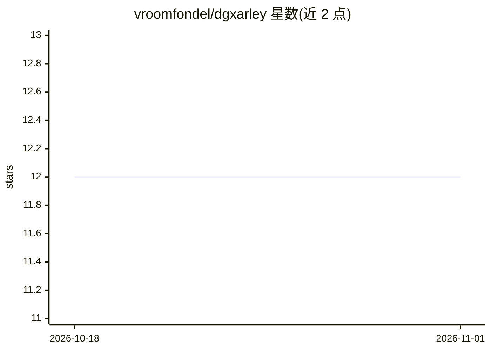

# vroomfondel/dgxarley

⭐ 12 · Python · LGPL-3.0 · 推送 2026-10-30 · [GitHub](https://github.com/vroomfondel/dgxarley) · 个人维护

**用 Ansible 部署 4 台 DGX Spark K3s 集群跑分布式 LLM 推理**

面向自建机房（homelab）场景的 Ansible playbook 集合：在 1 台 x86 控制节点与 4 台 NVIDIA DGX Spark（ARM64）节点上部署 K3s 集群，运行 SGLang 多节点流水线并行推理、Ollama、Open WebUI，并配套 docling-serve、SearXNG、cert-manager、Prometheus/Grafana/Loki、Seafile 等基础设施。网络层包含 VLAN/OVS 规划、QSFP mesh（NCCL）、MikroTik 交换机配置与策略路由。硬件拓扑与真实凭证绑定，跨机架多节点配置需按文档改写。

## 筛选速览

| 维度 | 判定 | 备注 |
|---|---|---|
| AI 角色 | `ai-ecosystem` | LLM/agent 周边工具 |
| 许可风险 | `viral` | LGPL-3.0 |
| 部署形态 | `library` | 以包/库形式分发 |
| 模型依赖 | — | README 未给出锁定关系 |
| 硬件要求 | — | 无带数字的原话,不猜 |
| 安装摩擦 | `medium` | 含编译或系统依赖之一 |
| 成熟度 | — | 结构信号不足 |

## 能力要点

- SGLang 4 节点流水线并行分布式推理（Multus + QSFP NCCL 网络）
- 11 个 Ansible role 覆盖系统加固、K3s、K8s 工作负载与基础设施
- VLAN/OVS 网络规划与 MikroTik RouterOS 交换机配置管理
- 配套 cert-manager、监控告警、Seafile、UPS 监控等自托管服务栈

## 适用场景

- 用 Ansible 一键部署 DGX Spark 多节点 LLM 推理集群
- 自建机房搭建含推理、存储、监控的完整 K8s 基础设施
- 参考 ARM64 GPU 集群的网络拓扑（VLAN/QSFP mesh）设计

## 场景标签

`推理引擎` · 领域:训练与推理

## 证据(README 行号)

> L9: Ansible-Repository for deploying a heterogeneous K3s cluster for distributed LLM inference,
> L122: |`k8s_dgx`|k3smaster|K8s workloads: Multus, NVIDIA device plugin, SGLang (distributed), Ollama, Open WebUI, SearXN
> L179: ### SGLang — Distributed LLM Inference

## 星数曲线

2026-10-18 12 → 2026-11-01 12（+0）

---
*卡片 v1 · prompt 1.4 · 生成 2026-10-31 · 置信度 high · 依据 README sha `2f41846991b7` · [字段定义](../../DATASET.md)*
