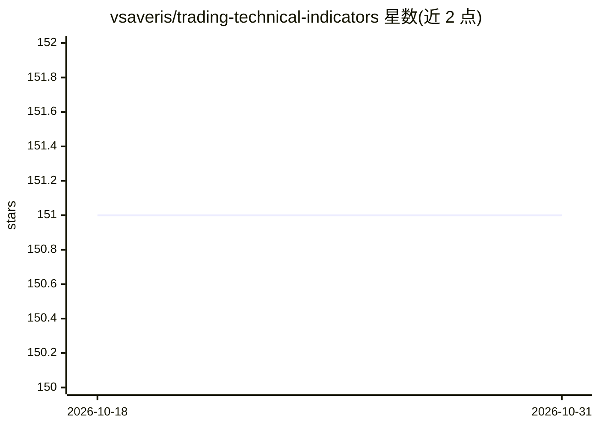

# vsaveris/trading-technical-indicators

⭐ 151 · Python · MIT · 推送 2025-11-23 · [GitHub](https://github.com/vsaveris/trading-technical-indicators) · [官网](https://trading-technical-indicators.readthedocs.io/en/latest/index.html) · 个人维护

**面向交易者的 Python 技术指标库（62 个指标+信号+模拟）**

Python 库 tti，提供 62 个传统技术指标（RSI、MACD、布林带等）、指标图生成、交易信号生成与交易模拟引擎，指标逻辑基于 Achelis《Technical Analysis from A to Z》并用配套电子表格验证。面向量化/交易开发者。README 标注 Machine Learning 集成为 coming soon，尚未交付；项目处于向 v1.0.0 的现代化改造中（Python 3.11+ 迁移、打包重整）。稳定版 0.2.2 经 pip 安装，开发版需 git clone 源码安装。

## 筛选速览

| 维度 | 判定 | 备注 |
|---|---|---|
| AI 角色 | `ai-enhanced` | 去掉 AI 部分产品仍成立 |
| 许可风险 | `permissive` | MIT |
| 部署形态 | `library` | 以包/库形式分发 |
| 模型依赖 | — | README 未给出锁定关系 |
| 硬件要求 | — | 无带数字的原话,不猜 |
| 安装摩擦 | `low` | 无编译、无系统依赖或容器化 |
| 成熟度 | `idea` | |

## 能力要点

- 62 个技术指标，含图生成与交易信号生成
- 内置交易模拟引擎
- 指标经《Technical Analysis from A to Z》配套表格验证
- 进行中的 v1.0.0 现代化改造（Python 3.11+、ML 预测管线）

## 适用场景

- 用 Python 计算并绘制交易技术指标
- 生成指标驱动的交易信号
- 对指标策略做交易模拟回测

## 场景标签

`金融量化` · 领域:学习与行业

## 证据(README 行号)

> L8: **Modern Technical Analysis + Python + Machine Learning**
> L17: - **Machine Learning integration (coming soon!)**

## 星数曲线

2026-10-18 151 → 2026-10-31 151（+0）

---
*卡片 v1 · prompt 1.4 · 生成 2026-10-22 · 置信度 mid · 依据 README sha `368a28e433db` · [字段定义](../../DATASET.md)*
