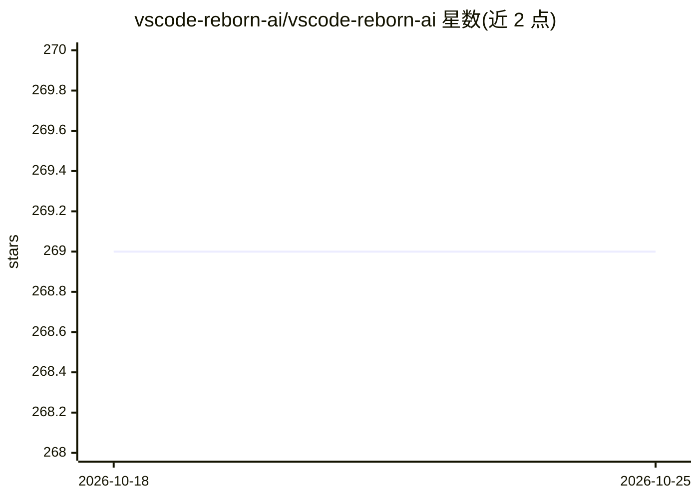

# vscode-reborn-ai/vscode-reborn-ai

⭐ 269 · TypeScript · ISC · 推送 2026-03-19 · [GitHub](https://github.com/vscode-reborn-ai/vscode-reborn-ai) · [官网](https://marketplace.visualstudio.com/items?itemName=chris-hayes.chatgpt-reborn) · 组织维护

**自带 AI 模型的 VS Code 编程助手扩展，支持本地与 API 模型**

VS Code 扩展，在编辑器内提供聊天界面，用于编写、重构与改进代码。用户自选 AI 后端：对 OpenRouter.ai（API）与 ollama（本地）提供增强支持，且任何兼容 OpenAI API 的工具均可接入。经测试可配合的本地运行时包括 text-generation-webui、ollama、LocalAI，API 侧包括 OpenRouter 与 Azure OpenAI Service。可通过 VS Code Marketplace、Open VSX Registry 安装，或用 yarn 从源码构建。界面翻译覆盖 20 余种语言。

## 筛选速览

| 维度 | 判定 | 备注 |
|---|---|---|
| AI 角色 | `ai-ecosystem` | LLM/agent 周边工具 |
| 许可风险 | `permissive` | ISC |
| 部署形态 | `None` |  |
| 模型依赖 | local-ok | 支持本地模型 |
| 硬件要求 | — | 无带数字的原话,不猜 |
| 安装摩擦 | `low` | 无编译、无系统依赖或容器化 |
| 成熟度 | — | 结构信号不足 |

## 能力要点

- 对 OpenRouter.ai 与 ollama 的增强支持
- 兼容任意 OpenAI API 兼容工具，含 LocalAI、text-generation-webui
- 通过 VS Code Marketplace / Open VSX 安装，或源码构建
- 界面翻译覆盖 20 余种语言

## 适用场景

- 在 VS Code 内通过聊天编写、重构与改进代码
- 离线使用本地 LLM 编程
- 自选 API 或本地模型后端接入编码助手

## 场景标签

`AI 助手` · 领域:对话与助手

## 证据(README 行号)

> L3: Write, refactor, and improve your code in VS Code using ai. With VSCode Reborn AI, you decide what AI you want to us
> L7: Enhanced support for: OpenRouter.ai (API), and ollama (local).

## 星数曲线

2026-10-18 269 → 2026-10-25 269（+0）

---
*卡片 v1 · prompt 1.4 · 生成 2026-10-22 · 置信度 high · 依据 README sha `8659ab61dfa2` · [字段定义](../../DATASET.md)*
