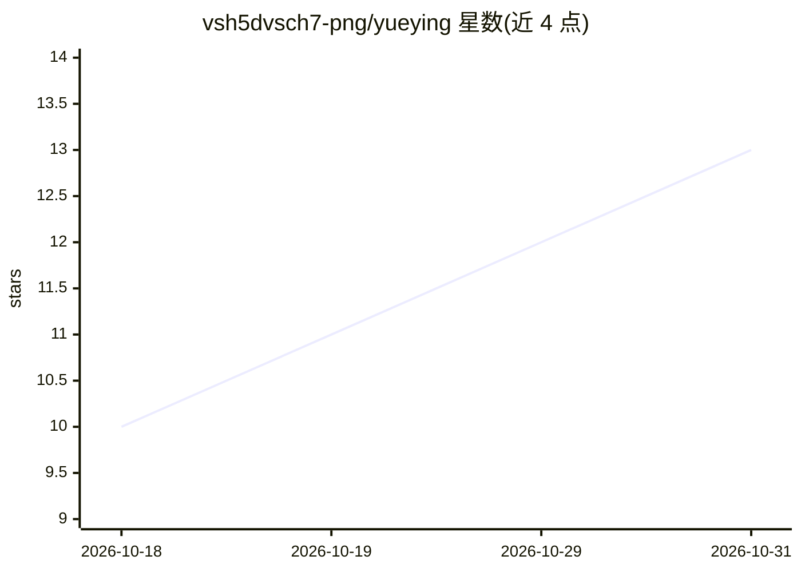

# vsh5dvsch7-png/yueying

⭐ 13 · Python · MIT · 推送 2026-09-13 · [GitHub](https://github.com/vsh5dvsch7-png/yueying) · [官网](https://pypi.org/project/yueying/) · 个人维护 · 中文 README

**让 AI 看视频的 MCP 服务器：本地/链接视频转时间戳转录与关键帧**

同一包提供 MCP 服务器、CLI 与 agent skill：输入本地视频或 YouTube/Bilibili 等链接（经 yt-dlp 取流，默认处理后删除），产出带 [mm:ss] 时间戳的转录（优先平台字幕，缺省时本地 faster-whisper，large-v3-turbo/CUDA 或 small/CPU 自动回退）、场景切变关键帧与 3x3 拼接图及 report.md。零 API key、无遥测，ffmpeg 随包捆绑。提供 Claude Desktop/Claude Code/Cursor/Cline/VS Code 等接入配置，支持 pip/uvx/Docker 安装。

## 筛选速览

| 维度 | 判定 | 备注 |
|---|---|---|
| AI 角色 | `ai-native` | 本体是模型或模型工具 |
| 许可风险 | `permissive` | MIT |
| 部署形态 | `desktop` | 安装包/桌面程序 |
| 模型依赖 | locked-api |  |
| 硬件要求 | — | 无带数字的原话,不猜 |
| 安装摩擦 | `low` | 无编译、无系统依赖或容器化 |
| 成熟度 | — | 结构信号不足 |

## 能力要点

- 优先用平台字幕，否则本地 faster-whisper 离线识别（GPU/CPU 自动回退）
- 关键帧取自场景切变并打包为带时间戳的 3x3 拼接图，控制 token 用量
- 支持 Bilibili/抖音/小红书等中文平台及 yt-dlp 覆盖的全部站点
- 一个包同时提供 MCP 服务器、CLI 与 agent skill 三种形态

## 适用场景

- 让 Claude/Cursor 等 agent 观看视频并回答其中内容
- 把课程或教程视频转成带时间戳的笔记和字幕
- 检索长视频中某话题出现的时间点并查看对应画面

## 场景标签

`语音识别` `图像视频处理` · 领域:感知与多模态

## 证据(README 行号)

> L14: Yueying (阅影) means "read video". One package gives you an **MCP server**, a **CLI** and an **agent skill**.
> L53: - **Captions first, Whisper only when needed.** Platform subtitles are used when they exist. Otherwise local faster

## 星数曲线

2026-10-18 10 → 2026-10-31 13（+3）

---
*卡片 v1 · prompt 1.4 · 生成 2026-10-31 · 置信度 high · 依据 README sha `b77ff690276e` · [字段定义](../../DATASET.md)*
