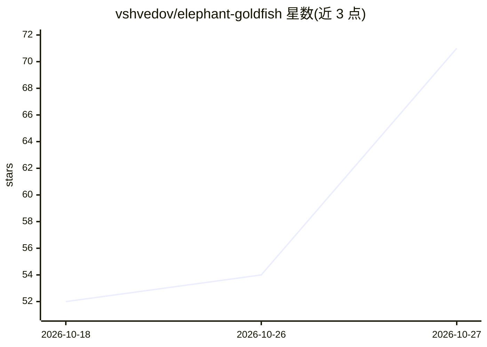

# vshvedov/elephant-goldfish

⭐ 71 · MIT · 推送 2026-05-12 · [GitHub](https://github.com/vshvedov/elephant-goldfish) · [官网](https://drensin.medium.com/elephants-goldfish-and-the-new-golden-age-of-software-engineering-c33641a48874) · 个人维护

**面向 AI 编程 agent 的可复用工作流：大象/金鱼协作模式**

基于 Dave Rensin 文章中的 Elephant/Goldfish 模式，为 Claude Code、Codex、Gemini CLI 提供可复用的软件开发工作流：五个阶段命令（eg-brainstorm 头脑风暴、eg-prd 需求文档、eg-new-feature 新功能、eg-fix-bug 修 bug、eg-precommit-review 提交前评审）。核心机制是用无上下文的金鱼子代理（subagent）对有大象（主会话）的产出做独立验证与发散。安装通过让 agent 拉取仓库中的 BOOTSTRAP.md 完成，Claude/Gemini 版本会按本地技术栈定制模板，Codex 版本安装共享技能并在运行时检查仓库。作者提示代价是更高 token 消耗与更长的过程。

## 筛选速览

| 维度 | 判定 | 备注 |
|---|---|---|
| AI 角色 | `ai-ecosystem` | LLM/agent 周边工具 |
| 许可风险 | `permissive` | MIT |
| 部署形态 | `None` |  |
| 模型依赖 | locked-api |  |
| 硬件要求 | — | 无带数字的原话,不猜 |
| 安装摩擦 | `low` | 无编译、无系统依赖或容器化 |
| 成熟度 | — | 结构信号不足 |

## 能力要点

- 五个阶段命令覆盖头脑风暴→PRD→实现→评审的流水线
- 金鱼子代理以无上下文方式独立验证大象的设计与诊断
- Adaptive Injection：按目标仓库的语言/框架/测试命令定制模板
- Claude Code、Codex、Gemini CLI 三平台可并存安装同一工作流

## 适用场景

- 让 AI 编程 agent 在写代码前先做设计与需求评审
- 用独立子代理交叉检验 bug 诊断与设计文档
- 为已有项目引入结构化的 PRD 与提交前评审流程

## 场景标签

`编码 Agent` · 领域:编码与开发

## 证据(README 行号)

> L5: A reusable workflow for software work with Claude Code, Codex, and Gemini CLI, built around the elephant/goldfish pa
> L111: |Brainstorm|`/eg-brainstorm`|`Use $eg-brainstorm ...`|`eg-brainstorm` Skill|
> L127: A fresh subagent spawned with no prior context. It receives only what you hand it: a problem statement, a design d

## 星数曲线

2026-10-18 52 → 2026-10-27 71（+19）

---
*卡片 v1 · prompt 1.4 · 生成 2026-10-24 · 置信度 high · 依据 README sha `d373aa5fe8a2` · [字段定义](../../DATASET.md)*
