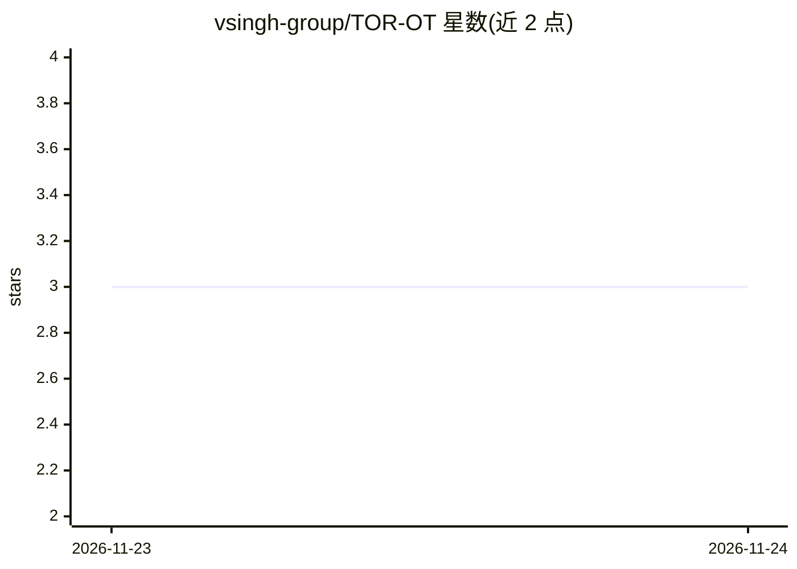

# vsingh-group/TOR-OT

⭐ 3 · Python · MIT · 推送 2026-11-19 · [GitHub](https://github.com/vsingh-group/TOR-OT) · 组织维护

**用 transformer 自回归生成稀疏最优传输方案的科研代码库**

NeurIPS 2026 论文的官方实现：将离散最优传输建模为序列生成任务，encoder 读取两个边际分布的逐 bin token 与代价类型 token，decoder 逐行解码稀疏传输方案（语法掩码贪心解码、KV cache）。附带数值 tokenizer、语料生成器（基于 POT 网络单纯形产生精确方案）、训练与评估流程；提供两个 157.6M 参数的预训练模型与三个合成语料（Hugging Face Hub）。安装依赖 torch、POT、datasets 等，训练需多 GPU。

## 筛选速览

| 维度 | 判定 | 备注 |
|---|---|---|
| AI 角色 | `ai-native` | 本体是模型或模型工具 |
| 许可风险 | `permissive` | MIT |
| 部署形态 | `library` | 以包/库形式分发 |
| 模型依赖 | — | README 未给出锁定关系 |
| 硬件要求 | — | 无带数字的原话,不猜 |
| 安装摩擦 | `low` | 无编译、无系统依赖或容器化 |
| 成熟度 | — | 结构信号不足 |

## 能力要点

- encoder–decoder transformer 将 OT 方案作为 token 序列逐行生成
- 提供 torot-1d / torot-2d 预训练模型与三个合成语料数据集
- 内置六个代价类型定义与训练/评估/复现脚本
- baselines/ 目录收录 POT、Meta OT、UNOT、NeuralOT 等基线适配

## 适用场景

- 预测给定边际与代价的最优传输方案
- 复现论文的 1D/2D 与 OOD 评估结果
- 生成大规模合成最优传输训练语料

## 场景标签

`模型训练` · 领域:训练与推理

## 证据(README 行号)

> L7: ToR-OT (**To**ken **R**egression for **O**ptimal **T**ransport) casts discrete optimal transport as sequence generat
> L35: * **Output.** The plan is generated one row at a time, and each row is conditioned on the rows before it.
> L90: |`torot/configs/torot_1d.yaml`|`ivanjaenm/torot-1d`|`ivanjaenm/torot_data_5M`|8 GPUs, 203,000 steps|

## 星数曲线

2026-11-23 3 → 2026-11-24 3（+0）

---
*卡片 v1 · prompt 1.4 · 生成 2026-11-23 · 置信度 high · 依据 README sha `2a41fc5a3588` · [字段定义](../../DATASET.md)*
