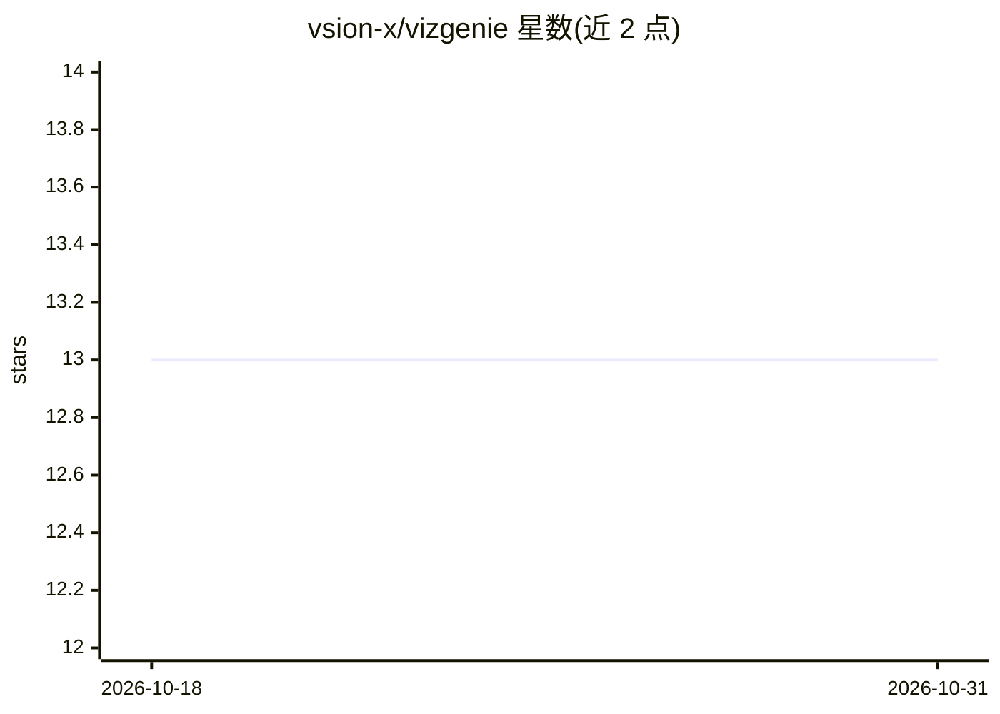

# vsion-x/vizgenie

⭐ 13 · Python · MIT · 推送 2026-02-19 · [GitHub](https://github.com/vsion-x/vizgenie) · 组织维护

**自然语言生成 Grafana 仪表盘的 agentic AI 应用**

基于 LangGraph 多 agent 工作流的 Streamlit 应用：将自然语言查询经意图抽取、指标提取、ChromaDB 向量检索、指标校验、PromQL/SQL 生成与校验、仪表盘 JSON 生成，最终通过 Grafana API 部署。支持 Prometheus 与 PostgreSQL 数据源，LLM 推理依赖 Groq API key（必需配置），可用 Docker Compose 一键拉起含 Grafana/Prometheus/PostgreSQL/ChromaDB 的完整栈，或本地 pip 安装运行。面向 DevOps 与监控场景用户。

## 筛选速览

| 维度 | 判定 | 备注 |
|---|---|---|
| AI 角色 | `ai-native` | 本体是模型或模型工具 |
| 许可风险 | `permissive` | MIT |
| 部署形态 | `self-host` | docker 或自建部署 |
| 模型依赖 | locked-api |  |
| 硬件要求 | — | 无带数字的原话,不猜 |
| 安装摩擦 | `low` | 无编译、无系统依赖或容器化 |
| 成熟度 | — | 结构信号不足 |

## 能力要点

- LangGraph 多 agent 流水线：意图→指标提取→向量检索→校验→查询生成→部署
- PromQL 与 SQL 查询生成，自动语法校验与最多 3 次重试
- ChromaDB 向量语义检索做指标发现，含缓存机制
- Docker Compose 提供含 Grafana/Prometheus/PostgreSQL/ChromaDB 的完整栈

## 适用场景

- 用自然语言快速生成 Grafana 监控仪表盘
- 不熟悉 PromQL/SQL 的运维人员从数据直接出可视化
- 对 Prometheus 指标与 PostgreSQL 业务数据混合建看板

## 场景标签

`多智能体` `RAG` `数据分析` · 领域:Agent 开发

## 证据(README 行号)

> L17: VizGenie is an **intelligent agentic AI system** that transforms natural language queries into production-ready Gra
> L72: |📊 **Metrics Extraction**|Metrics Agent|Extract metric names & labels via LLM|extract_metrics_tool + Groq LLM|

## 星数曲线

2026-10-18 13 → 2026-10-31 13（+0）

---
*卡片 v1 · prompt 1.4 · 生成 2026-10-31 · 置信度 mid · 依据 README sha `200e25f3d431` · [字段定义](../../DATASET.md)*
