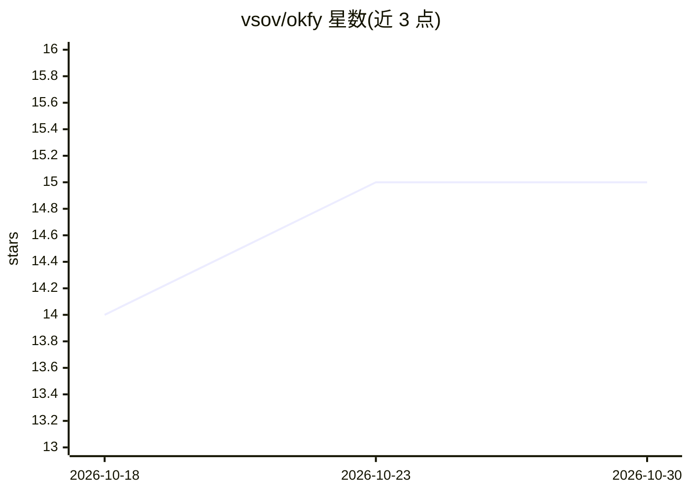

# vsov/okfy

⭐ 15 · Python · Apache-2.0 · 推送 2026-10-21 · [GitHub](https://github.com/vsov/okfy) · 个人维护

**把大语料蒸馏为可验证 git 原生知识包的知识工程工具**

面向 AI agent 的上下文装配工具：将超出上下文窗口的语料（代码库、文档、研究集合）提取为由 Purpose 定形的 OKF Bundle——自包含 Markdown 概念目录带 YAML frontmatter，任何 agent 可直接文件遍历消费。确定性部分（校验、BM25 检索、索引、分段、打包）在零 LLM 调用的 Python 核心 CLI 中，判断类工作由 Claude Code 插件命令驱动。检索无向量，靠 BM25 加词典查询扩展。质量验收靠可重放的 eval 与 owner 裁决，模型不可自证。

## 筛选速览

| 维度 | 判定 | 备注 |
|---|---|---|
| AI 角色 | `ai-ecosystem` | LLM/agent 周边工具 |
| 许可风险 | `permissive` | Apache-2.0 |
| 部署形态 | `None` |  |
| 模型依赖 | — | README 未给出锁定关系 |
| 硬件要求 | — | 无带数字的原话,不猜 |
| 安装摩擦 | `low` | 无编译、无系统依赖或容器化 |
| 成熟度 | — | 结构信号不足 |

## 能力要点

- 大语料提取为 Purpose 定形的自包含知识 Bundle，可被任意 agent 裸读
- Python 核心 CLI 零 LLM 调用、确定性 BM25 检索（无向量）
- Claude Code 插件驱动 Purpose 访谈、盲并行提取与合并审裁
- eval 可重放测试查询，仅 owner 裁决计入发布

## 适用场景

- 为 AI agent 从超大代码库或文档集准备精准上下文
- 把研究资料蒸馏为可审计的领域知识包
- 以 git 提交追踪知识包的演化与过期概念

## 场景标签

`知识库管理` `RAG` · 领域:知识与检索

## 证据(README 行号)

> L3: Tooling that eases context assembly for models. When a full knowledge base is
> L6: (codebases, docs, research collections) into purpose-shaped **OKF Bundles** and
> L16: (`core/`, PyYAML is its only dependency, zero LLM calls). The LLM-driven work —

## 星数曲线

2026-10-18 14 → 2026-10-30 15（+1）

---
*卡片 v1 · prompt 1.4 · 生成 2026-10-30 · 置信度 high · 依据 README sha `9357756457d6` · [字段定义](../../DATASET.md)*
